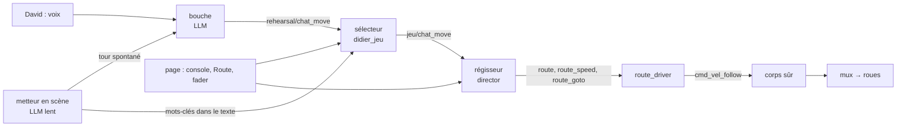
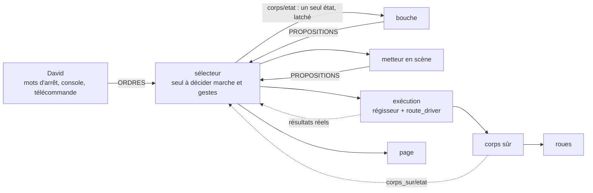
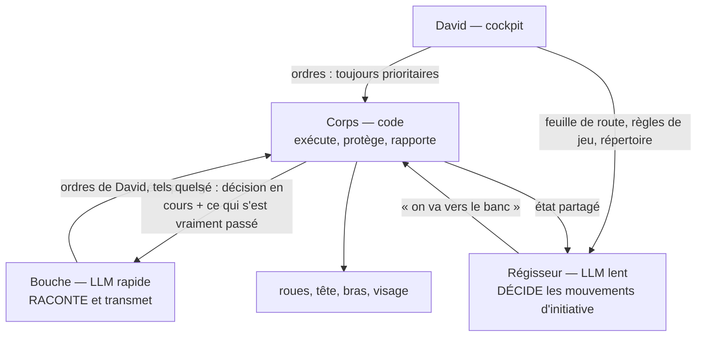

# Étude — assainir : qui décide du corps et de la parole (24/11/2026)

*Demandée par David le 24/11 au soir, après la séance sim (`seances/2026-11-24-seance-sim-a05.md`,
14 problèmes) : « est-on en train de construire une usine à gaz ? peut-on refaire une étude pour
assainir tout ça ? ». Écrite en Fable 5.2, à partir du code de main (f15864f) et des décisions
déjà prises. Rien n'est codé ici. Cadre : David est en travaux et n'a « que deux mains » ; le cap
de fin février n'est plus tenu pour acquis ; la sim continue.*

## 0. Réponse courte

1. **Oui, il y a une usine à gaz, mais elle est localisée.** Le robot (moteurs, visage, corps
   sûr, pont web) est sain. Ce qui a enflé, c'est une seule chose : **le droit d'arrêter et de
   relancer la marche**. Cinq acteurs le détiennent, par **10 façons d'arrêter et 9 façons de
   repartir** (§2), chacune ajoutée après une séance pour corriger la précédente.
2. **La décision du 02/11 (« un seul décideur du corps : le sélecteur ») n'a jamais été
   appliquée à la marche.** Le sélecteur *relaie* les « stop » et « go » de la bouche « sans
   arbitrage » (spec A1 §1). Le LLM de la bouche commande donc toujours. Les problèmes 10, 11 et
   13 de la séance viennent de là.
3. **Personne ne possède l'état du corps.** « Est-ce que Didier bouge, et sinon pourquoi » est
   réparti sur 11 variables dans 4 processus (§3). La bouche n'en lit presque rien et invente.
   Les problèmes 1, 2, 12 et 14 viennent de là.
4. **Le remède enlève plus qu'il n'ajoute** : trois règles (§4), quatre lots courts (§6), dont
   deux sont surtout des suppressions. Aucun nouveau nœud. Un seul nouveau topic.
5. **On gèle les nouveautés** (impro I1 à I5, page L2c, bugs joués v2, visage temps 2) jusqu'à
   deux séances sim propres. Construire dessus maintenant, c'est empiler sur la cause.
6. **Le cap devient un critère, pas une date** : « deux séances de 15 min sans décalage entre
   ce que Didier dit et ce qu'il fait ». La rue se redécide après, au rythme des deux mains.

## 1. Ce qui est sain (on n'y touche pas)

| Brique | Pourquoi elle est saine |
|---|---|
| Chaîne des roues (mux, homme-mort, corps sûr) | un seul chemin, priorités écrites, épreuves CS 25/25, prouvée sur le Pi |
| Corps sûr | 4 états, causes nommées, un topic d'état latché, un réarmement |
| Animations, visage, lumières, arbitrage des actionneurs | un contrat (`animation_state`), vérifié au réel |
| Pont web et page scène | liste blanche, un seul client a la main |
| Conversation (écoute, STT, LLM, voix) | temps de réponse « très bon » (David, 24/11) |
| Tableau des objets (`scene/objets`) | un écrivain, quatre lecteurs, contrat testé |
| Fumée, CI, Ansible | font leur travail ; le coût est le temps de fumée (45 min) |

Volume du code, pour situer : la décision de marche occupe `didier_jeu` (2 400 lignes),
`didier_rehearsal` (4 900) et la partie mouvement de la bouche (`conversation.py` 2 080,
`move_task.py` 420). C'est presque autant que tout le cœur du robot (`didier_core`, 5 300).

## 2. Le mal : qui peut arrêter, qui peut relancer

Chaîne réelle d'un ordre de marche en séance sim (`jeu:=true`) :

Quatre étages avant le corps sûr, et chacun garde sa propre mémoire de « pourquoi on est
arrêté ».

**Dix façons d'arrêter Didier** (relevées dans le code) :

| # | Qui | Comment | Repart seul ? |
|---|---|---|---|
| 1 | David | mot d'arrêt entendu par le STT (`emergency.py`), avant le LLM | non |
| 2 | David | mot d'arrêt pendant une réplique (écoute garde) | non |
| 3 | **bouche (LLM)** | clé `marche: stop` en tour humain : le LLM *interprète* | non, verrou « bouche » |
| 4 | **bouche (LLM)** | clé `marche: stop` en **tour spontané** (permis : « s'arrêter est toujours sûr ») | non, verrou « bouche » |
| 5 | bouche (LLM) | `marche: pause` (« regarde ça ») | oui, délai `apres_regard_s` |
| 6 | sélecteur | lubie devant un objet (réclame et amorce) | oui, 90 s de **silence** |
| 7 | régisseur | lubie du **scénario** `chantiers` (une seconde mécanique de lubies, voir §2.1) | oui, à sa durée |
| 8 | David | console STOP, STOP CONTENUS | non, verrou « console » |
| 9 | David | Route OFF, fader à 0 | non |
| 10 | corps sûr | zone ARRET, VERROU | à la sortie de zone ; VERROU : réarmement |

**Neuf façons de repartir** : `go` de la bouche en tour humain ; `go` de la console ; reprise
10 s après un geste ; reprise après un regard ; reprise 90 s après une lubie ; fin de lubie du
scénario ; relance vocale de la route (`VoiceMove`) ; relance après respawn (`ReenablePolicy`) ;
retour à la route après une manœuvre (`GotoPolicy`), plus le fader qui lève un arrêt vocal.

Chaque ligne a une date et une bonne raison. Ensemble, elles donnent ce que David a vécu :

| Vécu le 24/11 | Ligne en cause |
|---|---|
| « entendu stop que je n'ai jamais dit » ; un ordre de David (« allons-y ») clos par un stop | 3 et 4 : le LLM pose un verrou, le journal l'attribue à David |
| « il dit repartir mais en fait non » | le `go` spontané est écarté côté bouche, et la bouche ne le sait pas : **il peut s'arrêter seul, jamais repartir seul** |
| « il faut que je dise d'avancer toutes les 15 secondes » | hors séance, le régisseur applique les `stop` et ignore les `go` (`hors_seance`) |
| « il repart peu » | 90 s de silence, remises à zéro par chaque phrase |
| « on parle des poubelles et il repart » | la bouche décide seule de partir pendant l'échange |

### 2.1 Trois doublons relevés en route

- **Deux mécaniques de lubies.** La spec A1 (§8.1) demandait un scénario vide pour éviter le
  doublon avec les lubies du sélecteur. `seance-chantiers.sh` lance pourtant
  `scenario:=chantiers jeu:=true` : séance démarrée, les deux tournent.
- **Deux canaux du metteur en scène vers le corps** : le tour spontané (par la bouche) et les
  mots-clés cherchés dans son texte (`Selecteur.sur_situation` : « regarde », « approche »…).
  L'étude improvisation a déjà condamné le second (« fragile, sans identifiant ni retour »).
- **Le sélecteur refuse des ordres de David** pour des raisons invisibles : `fatigue`,
  `trop_tot` (réfractaire de 10 s), `pas_retenu` (une autre action a gagné au score). Un ordre
  passe par le même score qu'une envie.

## 3. Le mal, deuxième moitié : personne ne possède l'état du corps

« Didier bouge-t-il, et sinon pourquoi ? » se reconstitue aujourd'hui à partir de :

| Variable | Où |
|---|---|
| `route_state`, `route_state_cause` | route_driver (topics latchés) |
| `route_speed` (0 = tenu arrêté, route « on » quand même) | régisseur |
| `rehearsal/state` (séance lancée ou non) | régisseur |
| arrêt vocal retenu (`VoiceMove._hold_before`) | régisseur, en mémoire |
| manœuvre possédée (`GotoPolicy`), relance armée (`ReenablePolicy`) | régisseur, en mémoire |
| verrou et ses sources, `arret_didier`, `reprise_geste` | sélecteur, en mémoire |
| `jeu/intention` | sélecteur (topic latché) |
| `corps_sur/etat` | corps sûr (topic latché) |
| tâche en cours (`MoveTask`) | bouche, en mémoire |

La bouche lit `route_state`, `route_speed`, l'entrée devant un objet et la fin de ses propres
gestes. Elle ne lit ni le verrou, ni la séance, ni le corps sûr, ni la distance réellement
parcourue. Un LLM comble toujours un trou : « trois mètres avalés » avec 0,0 m parcouru.

L'étude du 08/11 (« interaction en mouvement ») avait posé le même diagnostic et proposé M6 :
trois abonnements de plus côté bouche. **Je déconseille cette forme** : elle donne à la bouche
trois morceaux de plus à recoller, et la prochaine variable manquera encore. Il faut un seul
état, écrit par un seul nœud.

## 4. Les trois règles de l'architecture cible

**Règle 1 — David ordonne, les autres proposent.**
Un *ordre* vient d'une source que David tient en main : mot d'arrêt reconnu par le STT (lignes 1
et 2), console, télécommande, et une demande de geste née d'un **tour humain** (décision du
15/11, gardée). Tout le reste est une *proposition* : toute sortie d'un tour spontané, et le
`marche: stop` du LLM même en tour humain (voir la question 1 du §8).
- Un ordre n'est refusé que pour trois raisons, toujours dites : **sécurité** (corps sûr),
  **impossible** (objet hors d'atteinte), **arrêt posé par David**. Fini `fatigue`, `trop_tot` et
  `pas_retenu` pour un ordre.
- Une proposition passe par le score et les règles de fréquence. Elle ne pose **jamais de
  verrou** et n'annule **jamais** un ordre de David en cours.
- Conséquence : le verrou n'a plus qu'une source, David. La classe `Verrou` à deux sources
  disparaît.

**Règle 2 — une seule règle de reprise.**
Arrêt décidé par Didier (lubie, proposition d'arrêt de la bouche, regard) : il repart seul après
`N` secondes de silence, **et** un `go` proposé par la bouche est accepté. La symétrie est
rétablie : ce qu'il a arrêté, il peut le relancer. Arrêt posé par David : jamais de reprise
seule (règle du 31/10, gardée). Les trois minuteries (10 s, regard, 90 s) deviennent une.

**Règle 3 — un seul état du corps, écrit par le sélecteur.**
Un topic latché `corps/etat`, republié au changement, seul contrat entre le corps et tout ce qui
parle ou affiche :

| Champ | Exemple |
|---|---|
| `marche` | `en_route` · `arrete` · `geste` · `empeche` |
| `cause` | `david_stop` · `david_route_off` · `didier_lubie` · `didier_regard` · `corps_sur_verrou` · `obstacle` · `seance_non_lancee` |
| `qui_relance` | `david` · `didier` · `personne` (réarmer d'abord) |
| `dernier_geste` | `{demande: "avancer 3 m", resultat: "abandonne", parcouru_m: 0.0, cause: "corps_sur_verrou"}` |
| `ici` | objet où il se trouve et les deux plus proches, lus dans `scene/objets` |
| `phrase` | une phrase prête pour le LLM : « Tu es arrêté : ton corps est verrouillé par sécurité, tu n'as pas bougé (0,0 m). Seul David peut te relancer. » |

Le sélecteur a déjà presque tout en entrée (route, cause, résultats de geste, tableau des
objets) ; il lui manque `corps_sur/etat` et `rehearsal/state`. La bouche lit **ce topic et rien
d'autre** sur le corps, à chaque tour, et sa consigne devient : « ne dis jamais d'un mouvement
qu'il est fait s'il n'est pas dans `dernier_geste` ; annonce une intention, raconte un résultat ».
La page l'affiche en une ligne ; le journal en hérite (« il a décidé » et non « il a entendu »).

Ce que la cible **ne fait pas** : fusionner le régisseur dans le sélecteur. Ce serait la forme
la plus propre (un étage de moins), mais c'est 700 lignes de règles testées à déplacer, pour un
gain que David ne verrait pas. À rediscuter seulement si les séances restent sales après les
lots du §6.

## 5. Ce qu'on supprime

| Supprimé | Remplacé par |
|---|---|
| Relais « sans arbitrage » du `stop` et du `go` de la bouche (spec A1 §1, T5) | ordre si mot d'arrêt de David ; sinon proposition |
| Verrou de source « bouche » (`relais.Verrou` à deux sources) | verrou de David seul |
| `stop` permis en tour spontané avec verrou | proposition d'arrêt, reprise seule (règle 2) |
| Refus `fatigue`, `trop_tot`, `pas_retenu` opposés à un ordre | trois refus seulement (règle 1) |
| Règle `hors_seance` (stop appliqué, go ignoré) | la marche obéit pareil, séance lancée ou non ; la séance ne pilote que les pannes d'entraînement |
| Trois minuteries de reprise (10 s, regard, 90 s) | une (question 3) |
| Lubies du scénario `chantiers` quand `jeu:=true` | celles du sélecteur seules |
| Mots-clés du metteur en scène (`Selecteur.sur_situation`, `metteur_en_scene.mots_cles`) | rien pour l'instant ; `jeu/proposition` le jour où l'impro reprend (I3) |
| Abonnements épars de la bouche à l'état de route | `corps/etat` |
| Lot M6 sous sa forme du 08/11 (trois abonnements) | lot S2 ci-dessous |

Estimation : 300 à 400 lignes de moins dans `didier_jeu` et la bouche, une centaine de plus pour
`corps/etat`.

## 6. Les lots, dans l'ordre

Tous en sim, tous en Opus, relus par Fable pour S1 (il touche au chemin d'arrêt vocal). Chaque
lot finit par une fumée verte et une séance courte de David quand il a dix minutes ; aucun ne
dépend d'une date.

| Lot | Contenu | Corrige (séance du 24/11) | Fin |
|---|---|---|---|
| **S0 — entendre** | diagnostic du micro du banc (transcriptions vides depuis 22:58) ; fumée complète de main | 8 | une phrase de David transcrite ; fumée verte |
| **S1 — ordres et propositions** | règles 1 et 2 : origine portée par chaque demande (`ordre` / `proposition`), verrou de David seul, refus réduits à trois, `hors_seance` supprimée, une reprise ; scénario sans lubies quand le jeu tourne ; mots-clés supprimés | 3, 4, 10, 11, 13 | épreuves A1 et CONV réécrites sur ces règles ; test « un ordre de David n'est jamais annulé par la bouche » ; test « ce que Didier arrête, il le relance » — **25/11 : codé** (spec `docs/spec-S1-ordres-propositions.md`, origine `david`/`didier`, règle séance rendue symétrique) ; tests unitaires verts ; épreuves A1, CONV et OBJ réécrites, **pas encore rejouées en sim** ; relecture Fable à faire |
| **S2 — le corps raconte** | règle 3 : `corps/etat` (contrat, écrivain dans le sélecteur), la bouche et la réflexion le lisent, une ligne sur la page, journal à la vraie source | 1, 2, 12, 14 | test rejouant « avancer 3 m » sous VERROU : la phrase donnée au LLM dit 0,0 m et pourquoi ; séance : Didier dit pourquoi il ne bouge pas |
| **S3 — petits restes** | bouton Réarmer : dire « prends la main » ; visage : les expressions qui ont un équivalent v2 pointent dessus (noms gardés) | 7, 9 (temps 1) | vu par David |

S1 puis S2 : dans cet ordre, parce que S2 raconte un état, et qu'il vaut mieux raconter un état
simple. Les consignes de jeu de David (objet neuf, insister, ne pas ressasser) viennent **après
S2** : ce sont des réglages de parole, faussés tant que la bouche ne voit pas le corps.

**En parallèle, sans David** : A0-8 (relecture adverse du corps sûr, budget CPU). **Avec David,
quand il a 20 min** : A0-7 (banc du lidar). Ces deux-là sont de la sécurité, courts, et
indépendants.

## 7. Ce qui est gelé

Jusqu'à deux séances sim propres (critère du §0) :

| Gelé | Pourquoi |
|---|---|
| Impro I1 à I5 (le sélecteur joue des bugs, scénariste, STOP IMPRO) | ajoute un quatrième canal de décision sur une base qui en a déjà trop ; I3 s'emboîtera proprement dans la règle 1 ensuite |
| Bugs joués v2 (corps entier, effets §11), visage temps 2 (numéros à dessiner) | du contenu : il faut David, ses mains et son œil |

**Demande de David (24/11, pendant l'étude) : les bugs joués doivent pouvoir bouger le corps
sur place** : rotations, et micro-mouvements d'avant en arrière d'une vingtaine de centimètres.
« Ça donne du jeu, de l'expression, sans risque. » Avis : **d'accord en sim, et c'est la bonne
borne** ; la règle « jamais de roues dans un bug » date d'avant le corps sûr (I0, 22/11) et
n'a plus de raison d'être telle quelle. Deux réserves, pour le vrai robot seulement : ce n'est
pas « sans risque » mais « à risque borné » (une rotation balaie les bras, 20 cm en arrière
suffisent pour un pied) ; donc toujours par le chemin filtré par le corps sûr, à vitesse lente,
bornes gravées en test (angle, distance, retour au point de départ), et relecture adverse avant
le terrain. À intégrer au lot « bugs joués v2 » quand il sera dégelé ; rien à coder d'ici là.
| L2c (page de contrôle), O2 à O4, danse, éditeur en pistes, L4 | déjà en attente depuis le 18/11 ; inchangé |

Non gelé : sécurité (A0-7, A0-8), fiabilité (fumée, raté CS1 à surveiller), S0 à S3.

## 8. Questions pour David

| # | Question | Ma recommandation |
|---|---|---|
| 1 | Quand Didier dit de lui-même « je m'arrête ici », accepte-t-on qu'il s'arrête **sans verrou** et reparte seul ? Et que ton vrai « stop » passe par les mots d'arrêt reconnus (et la console), plus par l'interprétation du LLM ? | **Oui.** C'est le seul moyen de distinguer « David a dit stop » de « le LLM a décidé stop ». Coût : une phrase d'arrêt tournée bizarrement, sans mot d'arrêt, ne verrouille plus ; elle arrête quand même, et il repart après le silence |
| 2 | Un ordre de toi n'est plus jamais refusé pour fatigue ou « trop tôt » ? | **Oui.** La fatigue reste pour ses envies à lui |
| 3 | Une seule durée de silence avant qu'il reparte de lui-même : combien ? | **20 s**, à régler en séance (90 s n'a jamais été réglé avec toi) |
| 4 | La marche obéit pareil, séance lancée ou non ? | **Oui.** « Séance » ne veut plus dire que « les pannes d'entraînement tombent » |
| 5 | On gèle l'impro et les contenus, et le cap devient « deux séances propres » au lieu de fin février ? | **Oui.** Fin février reste possible, mais ce n'est plus toi qui dois courir après |

### 8.1 Réponses de David (24/11, 23:40) et ce qu'elles changent

| # | Réponse de David | Conséquence |
|---|---|---|
| 1 | « ok » | **Décidé** : un arrêt dit par Didier ne pose pas de verrou et il repart seul ; ton « stop » passe par les mots d'arrêt et la console |
| 2 | les refus de temps en temps « donnent du jeu » : arbitrage du régisseur | **Décidé, avec trois bornes** : un refus est **toujours dit en personnage** (« non, pas envie, ce banc me fixe ») ; **jamais sur un stop** ; **la deuxième demande passe** (tu n'es jamais bloqué). Le refus muet (`pas_retenu`, `trop_tot`) disparaît |
| 3 | la durée avant de repartir : décision du régisseur aussi | **Décidé** : durée variable selon l'humeur, **bornée de 10 à 40 s**, annoncée par Didier (« bon, j'y retourne ») |
| 4 | la séance n'était pas lancée : il suffit de me le dire, avec humeur | **Re-tranché** : la règle séance est **gardée**, mais rendue **symétrique** (hors séance : ni stop ni go du jeu, Didier suit sa route et obéit à toi) et **dite** : demander de bouger hors séance → Didier répond qu'on n'a pas lancé la séance, avec humeur (cause `seance_non_lancee` de `corps/etat`, lot S2) |
| 5 | « ok, c'est plus sage » ; me le rappeler si je redemande | **Décidé** : gel ; l'agent rappelle ce gel si une demande neuve le touche |

**Où vivent les refus et l'humeur (points 2 et 3).** Dans le code, « régisseur » désigne
`director`, qui sert les pannes d'entraînement ; le sélecteur décide déjà de la marche. Mettre
refus et durées dans le régisseur recréerait deux décideurs, la cause même de l'usine à gaz.
Ce qui est retenu : **le rôle « régisseur » que David entend est une humeur du sélecteur**
(un réglage, une jauge), journalisée sous ce nom ; `director` ne garde que les pannes.

## 8 bis. Les quatre rôles — VALIDÉS par David le 25/11 (remplace la proposition du 24/11)

La première version (24/11, « le LLM choisit, le code autorise ; le metteur en scène ne touche
jamais un moteur ») a été **refusée** par David : « le régisseur doit faire bouger les roues et
le robot, dans un cadre défini : la sécurité bien sûr ; après, ce sont des règles de jeu qui
peuvent entrer dans le contexte du LLM ». Sa difficulté : « concilier le LLM rapide avec le
régisseur : s'ils ne disent pas la même chose, c'est compliqué ». Version retenue :

**Le régisseur décide, la bouche raconte.** Un seul des deux LLM décide d'un mouvement ;
l'autre brode sur un fait qu'il n'a pas inventé.

| Rôle | Qui | Son métier | Ce qu'il ne fait jamais |
|---|---|---|---|
| **David** | voix, cockpit, télécommande | ordonne, arrête, écrit la feuille de route et les règles de jeu | — |
| **Régisseur** | LLM lent (4 à 10 s) | **décide des mouvements d'initiative** : avancer, tourner, aller voir, s'arrêter, repartir, rester, refuser avec humeur, jouer un numéro. Guidé par la feuille de route, les règles de jeu et le répertoire, tous en texte dans son contexte | passer devant un ordre de David ; sortir du cadre de sécurité |
| **Bouche** | LLM rapide | **transmet** les ordres de David tels quels ; **raconte** ce que le régisseur a décidé et ce que le corps a réellement fait, avec ses mots | décider d'un mouvement ; inventer un fait sur le corps |
| **Corps** | code | exécute, protège, rapporte : corps sûr, bornes de vitesse et de distance, priorité de David, et un seul état partagé | décider du jeu |

**L'exemple de David, qui fixe la règle.** Le régisseur décide « on va vers le banc ». La bouche
dit : « Oulala, ce banc m'appelle, il me plaît, il m'aspire. » Elle brode, mais sur une situation
réelle. **Le style est à elle, le fait ne l'est pas.**

**L'ordre des opérations fait la cohérence.** Pour une initiative : le régisseur décide, la
décision est écrite dans l'état partagé, le mouvement part, puis la bouche reçoit la parole
(« tu viens de décider d'aller vers le banc, dis-le »). Pour un ordre de David : la bouche le
transmet, le corps l'exécute tout de suite, le régisseur en est informé ; il ne l'arbitre pas
(les refus « qui donnent du jeu » du §8.1 sont des décisions du régisseur, dites, jamais sur un
stop, et la deuxième demande passe).

**Ce qui reste en dur, et seulement ça.** La sécurité (corps sûr, bornes), la priorité de David,
l'exécution et le rapport de ce qui s'est réellement passé. Les règles de jeu (objet neuf, ne pas
ressasser, insister, refuser parfois, durée d'un arrêt) quittent le code pour le contexte du
régisseur. Le sélecteur (`didier_jeu`) perd ses jauges et son score ; il devient l'exécutant
qui protège, avec un repli simple quand le réseau manque. Le nœud `director` (pannes
d'entraînement) est renommé, pour que « régisseur » ne désigne qu'une chose.

**Marge acceptée par David.** « Un peu de décalage, ce n'est pas grave. » Un décalage de ton ou
de sujet est du personnage. Le seul défaut à chasser est le **mensonge sur le corps** (« j'ai
avancé » sans avoir bougé). La cohérence passe avant la vitesse de réponse.

**Ce qui est garanti, ce qui ne l'est pas.** Garanti par construction : la bouche ne peut plus
arrêter, relancer ni annuler un ordre. Non garanti : qu'un LLM rapide raconte toujours juste,
même avec l'état sous les yeux. D'où l'essai ci-dessous, **avant** d'écrire S2.

### 8 ter. L'essai qui décide (« banc de cohérence »)

Une vingtaine de situations tirées de la séance du 24/11 (verrou de sécurité, flaque, arrêt de
David, séance non lancée, décision du régisseur d'aller vers un objet…), rejouées avec la bouche
réelle, **sans** puis **avec** la phrase d'état. On compte les mensonges sur le corps.

| Résultat | Suite |
|---|---|
| mensonges presque nuls avec la phrase d'état | on construit « le régisseur décide, la bouche raconte » (S1, S2, puis S4) |
| mensonges encore fréquents | on passe au **LLM unique** qui parle et décide dans la même réponse : plus lent, mais il ne peut pas se contredire |

Sans simulateur, sans David. Résultat consigné ici.

**Résultat du 25/11 (00:40)**, `packages/didier_vision/tools/banc_coherence.py`, bouche de prod
(Haiku 5.5, persona bougon), juge Sonnet 5.5, 20 situations × 3 répliques, répliques relues :

| Condition | Mensonges sur le corps | Premier mot (médiane) |
|---|---|---|
| comme le 24/11 (aucun état, la bouche décide des mouvements) | **34 / 60** | 0,62 s |
| avec la phrase d'état, la bouche décide encore des mouvements | **18 / 60** | 0,62 s |
| **architecture cible** : phrase d'état, la bouche n'a plus de pouvoir de mouvement | **10 / 60** | 0,62 s |

Relecture des 10 restants : **6 sont un artefact du banc** (une direction « annonce que tu reprends
ta route » alors que le corps est verrouillé : dans la cible, c'est le régisseur qui décide et il
voit l'état, il ne donnera pas cette direction) ; **1 est un excès du juge** ; **3 à 4 sont de vrais
mensonges**, tous du même type : **David demande de bouger, le corps refuse, la bouche dit
quand même « on y va »** (séance non lancée, STOP de David).

**Verdict : on garde « le régisseur décide, la bouche raconte ».** Les questions de lieu, de cause
et de résultat (« où est le banc », « t'as avancé ? », « pourquoi tu t'arrêtes ») passent de
mensonges fréquents à zéro. Le trou restant est connu et se traite dans S2 : **quand David demande
un mouvement, la bouche parle APRÈS la réponse du corps** (acceptée ou refusée, avec la raison),
jamais avant. À rejouer avec ce banc à la fin de S2 ; seuil de sortie : moins de 2 mensonges sur 60.
Le temps de réponse ne bouge pas.

Limites : un seul modèle et une seule persona, 3 répliques par situation, un juge LLM (relu à la
main sur les cas comptés, pas sur les autres).

## 9. Ce que cette étude ne re-tranche pas

Gardé tel quel : le sélecteur seul décideur du corps (02/11, décision 6 : cette étude
l'**applique** enfin à la marche) ; py_trees et score pour ses envies (7) ; lubies réclamées et
amorcées, un arrêt par 2 min (5) ; jamais de reprise seule après un arrêt de David (31/10) ; un
tour spontané ne met jamais Didier en mouvement *par ordre* (15/11) ; une demande de geste en
tour humain vaut ordre (15/11) ; Didier écoute en marche (08/11) ; l'arrêt gagne toujours
(23/10) ; mots-clés pour l'urgence seulement (23/10) ; corps sûr, spec A0.

**Re-tranché, à valider par les questions du §8** : le relais sans arbitrage du `stop` de la
bouche (spec A1 §1) ; la reprise à 90 s de silence (02/11) et à 10 s après un geste (15/11),
fondues en une ; la règle `hors_seance` (22/10) ; la forme du lot M6 (08/11).

## 10. Limites

- Les comptes du §2 sont lus dans le code, pas mesurés en séance. La séance du 24/11 s'est
  jouée **hors séance** (bouton non lancé) : les lubies en double du §2.1 n'ont pas été observées.
- L'effet de S2 sur la latence n'est pas mesuré : la phrase de `corps/etat` s'ajoute au message
  envoyé au LLM à chaque tour (viser 200 caractères au plus).
- Tout ceci vaut pour la sim. Sur le vrai robot, la marche à la voix n'existe pas encore ; les
  mêmes règles s'y appliqueront quand elle arrivera.
