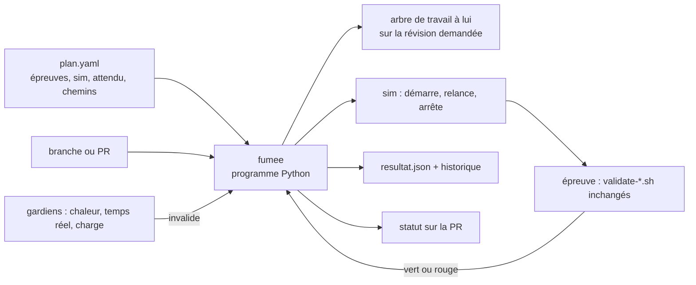

# Étude — une fumée digne de ce nom (25/11/2026)

Demande de David, le 25/11 au soir, après quatre fumées rouges dans la journée dont aucune
n'accusait Didier : « c'est l'usine, la fumée, 1 000 lignes de bash » ; « vu que mon PC va
fumer des mois, fais une étude pour un programme de fumée digne de ce nom ».

Étude écrite en Fable 5.2, sans code. Statut : **VALIDÉE par David le 25/11** (§8.1).

## 0. Réponse courte

La fumée mesure bien, mais elle est devenue un second chantier : 1 250 lignes de bash que les
agents retouchent tous les deux jours, une minuterie qui ne tourne plus depuis que le checkout
principal n'est plus sur `main`, dix scripts jetables dans `~/tmp` pour la contourner, et un
verdict qui ne sait dire que « vert » ou « rouge » alors que la moitié des rouges récents
viennent du banc (chaleur, course d'un test), pas de Didier.

Ce que je propose : **un petit programme Python, un plan d'épreuves déclaratif, trois verdicts
(vert, rouge, invalide), et la chaleur traitée à la source** (Gazebo dessine ses caméras sur le
processeur alors que le PC a une carte graphique inutilisée). Cinq lots courts, F0 à F4 ; les
deux premiers suffisent à sortir de la situation d'aujourd'hui.

## 1. Ce que la fumée fait bien (on le garde)

- Elle rejoue **tout** sur une vraie sim, quatre conteneurs, et compare à des compteurs gravés.
- Elle refuse de mesurer sur un banc faux : temps réel sous 0,8, sim de quelqu'un d'autre,
  domaine ROS différent de 43.
- Les scripts d'épreuve (`validate-*.sh`, 3 700 lignes) sont le vrai capital : ils disent ce
  que Didier doit faire. Ils ne sont pas en cause et ne sont pas réécrits.
- Les journaux bruts sont gardés hors dépôt, purgés seuls.

## 2. Ce qui ne va pas (mesuré le 25/11)

| Constat | Mesure |
|---|---|
| Taille | `fumee.sh` 1 250 lignes, `fumee_page.py` 677, outillage autour 720 ; 28 commits sur ces deux fichiers en 18 jours, sur 357 commits du dépôt |
| La minuterie ne sert plus | toutes les 30 min elle répond « le checkout est sur `etude-visage`, pas sur `main` » ; avant, 34 reports pour « plage sans commit », 22 pour « sim de quelqu'un » |
| Contournement | 10 scripts jetables dans `~/tmp` (un par fumée lancée par un agent), chacun avec sa propre garde de température, hors dépôt, jamais testés |
| Pas de mémoire | ces fumées n'écrivent pas dans l'historique : « aucune fumée verte de référence », donc les quatre images sont reconstruites à chaque fois (24 min sur 53) |
| Tout ou rien | arrêt au premier rouge : le 25/11, une fumée a rendu 13/14 sur A1 et rien sur les deux épreuves suivantes ; il a fallu relancer 50 min pour un point |
| Deux verdicts seulement | historique : 32 vertes, 8 rouges. Le 25/11 : 4 rouges, 0 imputable à Didier (1 course dans une épreuve, 3 par la chaleur) |
| La chaleur | garde externe qui met la sim en pause à 85 °C : la pause fige horloges et capteurs, les épreuves chronométrées tombent. Jusqu'à 12 pauses dans une seule épreuve |
| Source de la chaleur | Gazebo rend les caméras **sur le processeur** (aucun réglage graphique dans le compose) ; le PC a une RTX 4060 dont 211 Mo sur 8 Go servent, et le runtime `nvidia` de Docker est installé |
| Cinq redémarrages de sim | stage, chantiers, A1, objets, conversation : à chaque fois quatre `colcon build` (1 à 4 min) |
| Le PC n'est pas un banc | d'autres charges y démarrent sans prévenir en journée ; la fumée ne peut ni les voir venir ni les arrêter |
| Rien sur la PR | le verdict vit dans une page HTML locale ; la règle « fusion seulement fumée verte » repose sur la mémoire de l'agent |

**Le fond du problème.** La fumée a été conçue le 07/11 comme une veille de nuit sur `main`.
Elle sert aujourd'hui à autre chose : **valider un lot avant sa fusion, plusieurs fois par jour,
sur une branche**. Tout ce qui fait mal vient de cet écart d'usage.

## 3. Ce que « digne de ce nom » veut dire

Six critères, qui servent de critères de sortie :

1. **Un rouge accuse Didier.** Tout le reste (chaleur, temps réel trop bas, enregistreur mort,
   réseau) s'appelle « invalide », se rejoue seul et ne bloque jamais une fusion à tort.
2. **Une commande, n'importe quelle branche** : `fumee <branche ou PR>`. Plus de script jetable.
3. **Le verdict est sur la PR**, épreuve par épreuve. La règle de fusion se lit, elle ne se
   retient pas.
4. **Un lot ordinaire coûte moins de 20 minutes** : on rejoue ce que le lot touche ; la fumée
   complète reste, la nuit ou avant une sortie.
5. **Elle tourne en journée** sur ce PC sans le faire dépasser 85 °C.
6. **Moins de 700 lignes à nous, testées** (hors scripts d'épreuve), que David peut relire.

## 4. La cible

**Un plan déclaratif.** Un fichier `plan.yaml` remplace les fonctions `phase_*` :

| Champ | Exemple |
|---|---|
| `id`, `script`, `attendu` | `a1`, `validate-jeu-a1.sh`, 14 |
| `sim` | monde `chantiers`, régie `jeu-a1`, jeu oui, tête non |
| `delai_s` | 1500 |
| `bloque` | les épreuves qui ne valent rien si celle-ci est rouge (corps sûr bloque les répétitions) |
| `chemins` | ce qui la rend nécessaire : `packages/didier_jeu/**`, `packages/didier_rehearsal/**` |

Ajouter une épreuve devient une entrée de dix lignes, plus une fonction de plus dans du bash.

**Trois verdicts.** Vert ; rouge (le compteur de l'épreuve est faux, banc sain) ; **invalide**
(un gardien a parlé pendant l'épreuve). Une épreuve invalide est **abandonnée tout de suite**,
le PC refroidit, puis elle est rejouée, deux fois au plus. On ne met plus la sim en pause :
une pause fabrique des faux rouges, un abandon fabrique un rejeu.

**Les épreuves sont indépendantes.** Un rouge n'arrête que ce qu'il bloque réellement
(démarrage, temps réel, corps sûr). Une fumée rend toujours tous les compteurs qu'elle peut.

**Son propre arbre de travail.** Le programme tient un arbre à lui, qu'il place sur la
révision demandée. Le checkout de David peut être sur n'importe quelle branche, sale ou non.

**Rejouer ce qui est touché.** Les `chemins` du plan donnent, pour une PR, la liste des
épreuves nécessaires ; `--tout` force la fumée complète. Une fumée complète reste due avant
toute sortie sur le robot et une fois par semaine.

**Le verdict sur la PR.** Un statut GitHub par fumée (« fumée : 14/14 épreuves » ou la
première rouge), posé par `gh` depuis le PC. Pas d'exécuteur GitHub installé sur le PC de
David : sur un dépôt public, n'importe quelle PR venue d'ailleurs pourrait y faire tourner du
code.

**La chaleur à la source.** Faire dessiner les caméras de Gazebo par la carte graphique
(runtime `nvidia`, rendu sans écran). Si la mesure le confirme, le processeur perd sa plus
grosse charge et le gardien ne sert plus que de filet.

## 5. Ce qu'on supprime

| Supprimé | Remplacé par |
|---|---|
| `fumee.sh` (1 250 lignes), sauf l'extinction « et dodo » | le programme Python (environ 500 lignes) |
| `fumee_page.py`, pour sa moitié « décision due / pas due » | `resultat.json`, statut GitHub, une page HTML réduite |
| Les 10 scripts jetables de `~/tmp` et leurs gardes | `fumee <révision>` |
| La mise en pause de la sim par la chaleur | abandon et rejeu de l'épreuve |
| La reconstruction des images « faute de référence verte » | cache indexé sur l'empreinte des fichiers qui font l'image |
| La règle « le checkout doit être sur main » | l'arbre de travail du programme |
| Le rejeu de phase ajouté en bash le 25/11 (110 lignes, non commité) | rien : il n'entre pas dans le dépôt |

## 6. Les lots

Tous en Opus, sans David sauf mention. Chacun finit par une fumée complète verte du nouveau
programme, comparée épreuve par épreuve à l'ancienne.

| Lot | Contenu | Fin |
|---|---|---|
| **F0 — mesurer** | 1) caméras de Gazebo sur la carte graphique : température, charge et temps réel avant/après, sur l'épreuve A1 ; 2) la même épreuve sur une machine gratuite de GitHub (4 cœurs) : temps réel tenu ou non | deux chiffres ; on sait si la chaleur disparaît, et si une exécution hors du PC est possible |
| **F1 — le programme** | plan déclaratif, trois verdicts, épreuves indépendantes, abandon et rejeu, arbre de travail propre, cache d'images, mode hors ligne (§8.1, réponse 4) ; l'ancienne fumée reste en place | même verdict que l'ancienne sur une fumée complète ; une épreuve rendue invalide exprès (charge artificielle sous 85 °C) est rejouée seule |
| **F2 — au service des lots** | épreuves choisies par les chemins touchés ; statut posé sur la PR ; file d'attente (une fumée à la fois, les suivantes attendent) | une PR qui ne touche que la bouche est validée en moins de 20 min, verdict lisible sur GitHub |
| **F3 — le ménage** | suppression de `fumee.sh`, de la moitié de `fumee_page.py`, des scripts de `~/tmp` ; la minuterie appelle le nouveau programme ; doc | moins de 700 lignes à nous ; `operations.md` raccourci |
| **F4 — hors du PC** (seulement si F0 le permet) | les épreuves sans temps réel serré tournent sur GitHub à chaque PR ; le PC ne garde que les chronométrées | le PC de David fume deux à trois fois moins |

F0 et F1 débloquent tout le reste, y compris S1 de l'assainissement, qui a besoin d'une
fumée fiable pour être fusionné. Ordre recommandé : **F0, F1, puis reprise de S1** ; F2 et F3
entre deux lots S ; F4 selon la mesure.

## 7. Ce que cette étude écarte

- **Réécrire les scripts d'épreuve.** Ils marchent ; le défaut est dans l'enchaînement.
- **Un exécuteur GitHub sur le PC de David** : risque de sécurité sur un dépôt public.
- **Louer une machine.** Pas tant que F0 n'a pas dit ce que valent la carte graphique et les
  machines gratuites.
- **Un outil de test tout fait** (pytest pour piloter la sim, `launch_testing`). Séduisant,
  mais il faudrait y faire entrer les `validate-*.sh` un par un : c'est la réécriture écartée
  plus haut. À revoir si les épreuves doivent un jour être réécrites.

## 8. Questions pour David

1. **L'ordre** : F0 et F1 avant de reprendre S1 (deux sessions), ou S1 d'abord avec des fumées
   le soir ? Je recommande F0 et F1 d'abord : chaque lot à venir en dépend.
2. **Le statut sur la PR** suppose que les agents posent un statut GitHub pendant tes heures
   de travail. C'est une trace d'agent, pas un échange avec toi : d'accord ?
3. **La fumée complète de nuit** : la garder, sachant que tu éteins le PC ? Sinon, une fois
   par semaine, lancée à la main avant d'aller dormir (« et dodo »).

### 8.1 Réponses de David (25/11, 22:00)

| # | Réponse | Conséquence |
|---|---|---|
| 1 | « ok » | **Décidé** : F0 puis F1, avant la reprise de S1 |
| 2 | « ok » | **Décidé** : les agents posent un statut GitHub sur la PR, aussi en journée (trace d'agent, pas d'échange avec David) |
| 3 | « ok, mais tu fais dix fumées par jour, j'ai l'impression » | **Décidé** : une fumée complète la nuit, gardée. Et une **borne** : hors la nuit, plus de fumée complète pour valider un lot ; un lot rejoue seulement ce qu'il touche (F2). Le 25/11, cinq fumées complètes ont été lancées, dont trois perdues pour la chaleur ; F1 (rejeu de l'épreuve invalide) et F2 (rejeu ciblé) visent **une fumée complète par nuit, et pour chaque lot une fumée de 10 à 20 min** |
| 4 | « je peux lancer des fumées le midi, mais souvent sans internet » | **Décidé** : **mode hors ligne** dans F1. La sim n'a besoin du réseau que pour trois choses : reconstruire une image (paquets téléchargés), l'épreuve de conversation (API Anthropic) et poser le statut sur la PR. Hors ligne : images prises dans le cache, jamais reconstruites (image absente du cache : fumée « invalide : hors ligne », pas rouge) ; conversation « non lancée (hors ligne) » ; statut GitHub mis en file et posé au retour du réseau |

## 9. Limites

- Le gain de la carte graphique n'est **pas mesuré** : c'est l'objet de F0. S'il est nul, le
  gardien reste la seule protection et les fumées de journée resteront plus lentes.
- Les « moins de 20 minutes » supposent que la plupart des lots ne touchent qu'une ou deux
  épreuves. Un lot qui touche le cœur rejoue presque tout.
- Les 500 lignes sont une estimation, pas un engagement ; le critère est « relisible par
  David », pas le chiffre.
