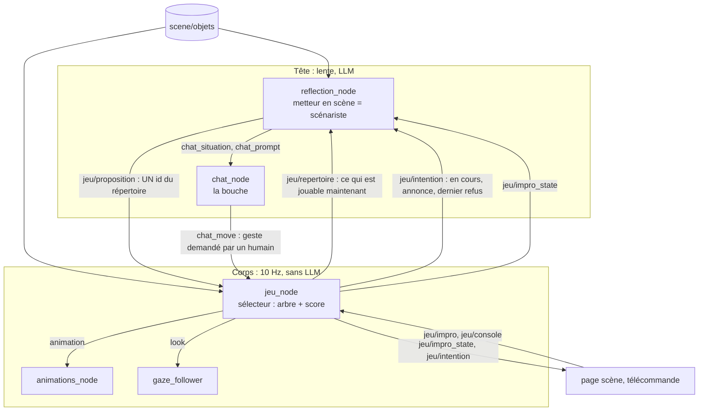
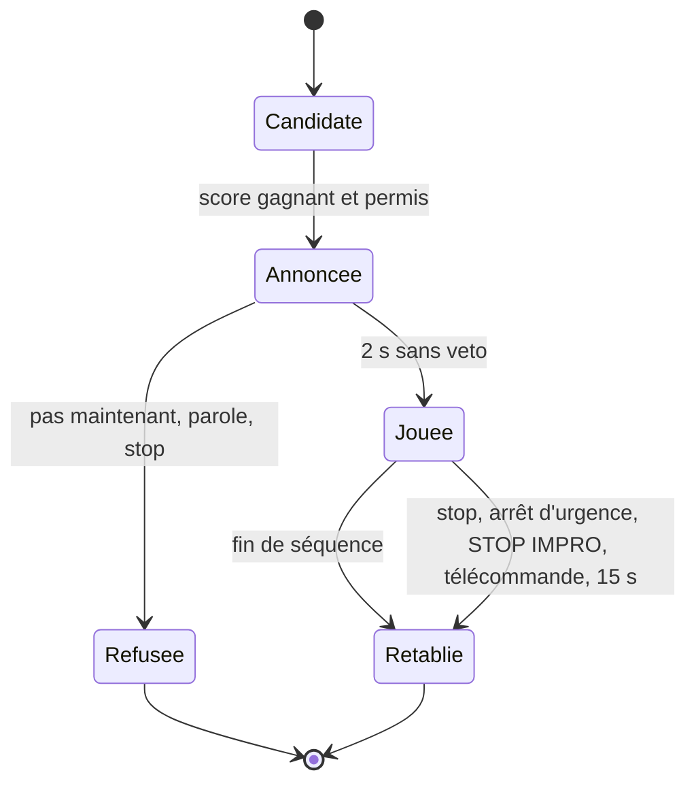

# Improvisation en vrai — bugs joués, scénariste, STOP IMPRO

*Écrite le 2026-11-21 (Fable). Statut : **VALIDÉE le 22/11** (réponses de David au §9, lots
mis à jour au §7) ; **lot I0 fait le 22/11** (§11).
Elle s'appuie sur les décisions du 02/11 ([`etude-autonomie-improvisation.md`](../etude-autonomie-improvisation.md) §8),
du 17/11 (bugs JOUÉS sur le vrai robot) et du 18/11 (Didier joue de lui-même, STOP IMPRO, panneau
Coulisses) : elle ne les re-tranche pas (§10). Tout ce qui est dit « existe » a été relu dans le
code le 21/11 (§1).*

## 0. Réponse courte

1. **Un bug joué est une entrée du répertoire**, pas une panne : une séquence courte (15 s au
   plus) sans piste `wheels` ni `relay`, que le sélecteur de jeu choisit, annonce, joue et
   **rétablit**. Catalogue de départ : 8 bugs, dont 6 sans servo (visage, son, lumières), jouables
   sur le vrai robot dès le visuel de David, et 2 avec cou ou bras, qui attendent le protocole
   caméra hors sol (§2).
2. **Le metteur en scène devient scénariste sans appel LLM de plus** : un champ `jouer` dans le
   JSON qu'il produit déjà, qui nomme **un identifiant du répertoire**. Ce choix arrive au
   sélecteur comme une **proposition** qu'il pèse avec le reste et qu'il peut refuser. Le
   scénariste choisit *quoi* ; le sélecteur garde *si* et *quand* (§3). Sans réseau, le sélecteur
   continue de jouer seul, par l'ennui.
3. **STOP IMPRO** = un topic de commande `jeu/impro` et un état latché `jeu/impro_state`. Éteint
   au démarrage, il retombe seul à OFF si plus personne n'a de bouton sous la main. Il coupe dans
   le sélecteur (première branche de l'arbre) et dans la réflexion (plus de prise de parole
   spontanée). Il ne touche jamais aux roues (§4).
4. **Le panneau Coulisses existe** (18/11) : on lui ajoute un bloc « Didier s'apprête à… » nourri
   par `jeu/intention`, avec un préavis de 2 s et un bouton « pas maintenant » (§5).
5. **Une épreuve de fumée `IMPRO`**, 15 verdicts (§6), et **cinq lots** I0 à I4, environ 29 h
   d'Opus et 2 h de Fable, plus un lot I5 quand le robot est remonté (§7).

## 1. Ce qui existe — relevé dans le code le 21/11

| Brique | État réel | Conséquence |
|---|---|---|
| `data/json/sequences/bugs/bug1..5.json` | 5 séquences de type `bug`, 30 s, **toutes avec une piste `wheels`** (± 0,6) | inutilisables telles quelles ; le répertoire les exclut déjà deux fois (`DOSSIER_EXCLU`, filtre roues de `repertoire.candidates`). On n'y touche pas |
| Visages (`expressions.json`) | `glitch total`, `repos glitch`, `off`, `upgrade`, `internet`, `warning`, `brain`, `fuzz`, `surprise`, `tristesse`, `reflechit` | la matière visuelle des bugs existe |
| Lumières (`robot_lights.json`) | `scan`, `transfer`, `trip`, `color cycle`, `off`, `default` | idem |
| Sons | aucun son de démarrage, de bégaiement ni de bips dédié ; les audios vivent hors dépôt (manifeste `audios-prives.json`) | **3 sons à fabriquer** (§2.3) |
| Sélecteur `didier_jeu` | arbre py_trees + score, offres (`personne` 0,7 · `objet` 0,8 · `bouche` 0,9), pulsions, réfractaires, journal « pourquoi », intention latchée ; emplois `accueil` et `spontanee` seulement ; **refuse de démarrer hors domaine 43** (il dépend du régisseur pour les roues) | il lui manque l'emploi `bug`, la coupure d'impro, et un mode « vrai robot, sans roues » |
| Metteur en scène → sélecteur | **par mots-clés** : `Selecteur.sur_situation` cherche « regarde », « salue », « danse », « approche » dans le TEXTE du tableau de situation (poids 0,8, péremption 5 s) | fragile, sans identifiant ni retour : à remplacer (§3.2) |
| `reflection_node` | un appel JSON (`situation`, `direction`, `mission`, `parler`, `raison`) ; cadence : 4 s au moins entre deux appels, battement de 20 s seulement si engagé ; lit déjà `scene/objets` | le champ `jouer` s'y ajoute sans nouvel appel |
| Lubies | 30 textes liés aux POI du monde `chantiers` ; le sélecteur les amorce sur `rehearsal/poi_event` (réclame ET amorce, 3 s de refus possible, 1 arrêt par 2 min, reprise à 90 s) | mécanisme complet en sim ; en rue il n'y a ni POI ni carte : les lubies sur objets VUS attendent le lot O2 (caméra dans le tableau) |
| 20 pannes du régisseur | SIM-ONLY (relais roues, processus mis en pause, pannes de conversation) | restent ce qu'elles sont : de vraies pannes pour entraîner David, jamais sur le robot |
| Panneau Coulisses (`scene.html`, `scene.js`) | situation, âge, prise de parole spontanée, mission, journal du régisseur ; repliable, état mémorisé | il ne montre pas ce que le sélecteur va faire (`jeu/intention` est dans le panneau « Jeu », caché hors sim) |
| STOP CONTENUS (`web_protocol.stop_all_commands`) | `animation false` + `stop` sur chaque organe ; en répétition, `stop` au sélecteur | sur le vrai robot, rien n'empêcherait le sélecteur de rejouer 8 s plus tard |
| Corps sûr | A0-2/A0-3 fusionnés, A0-4 (insertion avant le mux) à venir | les bugs joués n'en dépendent pas : ils n'émettent aucune consigne de roues |
| Arbitrage | `animation_state` latché : regard et bouche se taisent sur visage et tête tant qu'une séquence joue | un bug joué comme une séquence hérite de l'arbitrage, sans code |

## 2. Catalogue des bugs joués

### 2.1 Définition et garanties

Un bug joué = **une séquence** de `data/json/sequences/bugs-joues/` (dossier neuf, types
`["bug-joue"]`) + **une direction facultative** pour la bouche, dite après le bug. Garanties,
chacune portée par du code et un test à valeur gravée :

| Garantie | Où |
|---|---|
| aucune piste `wheels` ni `relay` (un faux redémarrage ne coupe aucune vraie alimentation) | chargement du répertoire : refus du fichier ; test d'inventaire sur le dossier |
| durée ≤ 15 s (`bug.duree_max_s`, borne dure des réglages) | chargement ; chien de garde du sélecteur à l'exécution |
| son ≤ 4 s d'affilée (la porte audio est fermée pendant un son : le « stop » vocal est sourd) | chargement (durée lue au manifeste des audios) |
| rétablissement : visage `stop`, cou au centre, bras au repos, lumières `default`, `animation_state` vide | sélecteur, à la fin ET à toute coupure (liste gravée, celle de STOP CONTENUS plus les lumières) |
| aucune consigne de roues pendant le bug : pas de départ si Didier roule de lui-même sans s'être arrêté d'abord (même relais `stop` sans verrou puis `go` que « regarde ça ») ; coupure si la télécommande envoie une consigne non nulle | sélecteur |
| jamais deux fois de suite le même, jamais pendant qu'on parle | score et réfractaires (§3.4) |

Option écartée : rejouer les pannes du régisseur sur le robot (geler un processus, jeter des
messages) — ce sont de vraies pannes, non bornées par construction, et la décision du 17/11 dit
« on ne casse rien de réel ». Option écartée : pannes de conversation `deaf`, `garble`, `delay`
en vrai — elles dégradent l'écoute, déjà le point faible ; un bug de voix est un son joué.

### 2.2 Les huit bugs de départ

Classe **V** = visage, son, lumières, yeux (aucun servo porteur) : vrai robot après le visuel de
David. Classe **M** = cou ou bras : vrai robot après le protocole caméra hors sol (décision du 17/11).

| id | Ce que le public voit | Visage | Son | Cou | Bras | Lumières | Voix ensuite (direction) | Classe | Durée |
|---|---|---|---|---|---|---|---|---|---|
| `glitch_visage` | le visage se déchire puis revient | `glitch total` → `repos glitch` | — | — | — | `trip` | — | V | 3 s |
| `ecran_noir` | tout s'éteint, puis il sursaute | `off` → `surprise` | — | — | — | `off` → `default` | « tu ne t'es rendu compte de rien » | V | 4 s |
| `lumieres_folles` | les rubans s'emballent, yeux affolés | `warning` | — | — | — | `color cycle` | « ce n'est pas toi, c'est l'éclairage public » | V | 5 s |
| `begaiement` | il bute sur une syllabe en boucle | `speak` saccadé | **à fabriquer** (≤ 3 s) | — | — | `speak` | reprend sa phrase comme si de rien n'était | V | 4 s |
| `mise_a_jour` | « mise à jour 3 sur 47 », il attend | `upgrade` → `internet` | **bips à fabriquer** | — | — | `scan` | « ne pas éteindre le robot » | V | 8 s |
| `faux_redemarrage` | noir, démarrage, il revient changé | `off` → `upgrade` → `default` | **son de démarrage à fabriquer** | — | — | `off` → `transfer` → `default` | « pendant le noir, tu as vu quelque chose » (le prétexte de quête de l'étude répétition §2) | V | 12 s |
| `tete_figee` | il se fige en plein geste, puis se secoue | visage gelé sur `repos glitch` | — | tenu de côté (≤ 30°, la course utile est ± 36°) | — | — | « où en étais-je ? » | M | 6 s |
| `bras_en_greve` | un bras retombe, l'autre le désigne | `tristesse` | — | regard vers le bras | gauche au repos, droit levé | — | « mon bras gauche est en grève, c'est légal » | M | 8 s |

Les deux bugs de la classe M reprennent des pannes réellement vécues (visage figé du 13/07, bras
muet), comme le demande l'étude répétition : on ne joue que des bugs vrais.

### 2.3 Ce qui manque

- les 8 fichiers de séquence (pistes existantes : `faces`, `audios`, `neck`, `left_arm`,
  `right_arm`, `left_eye`, `right_eye`, `robot_lights`) ;
- 3 sons, fabriqués en synthèse (voix de Didier + effets), rangés avec les audios privés et
  déclarés au manifeste ;
- l'emploi `bug` du répertoire, et tout le §3 ;
- pour la classe M : le protocole caméra hors sol (lot I5).

## 3. Comment le metteur en scène décide

### 3.1 Les options

| Option | Verdict | Raison en une ligne |
|---|---|---|
| A. Garder les mots-clés dans le texte de situation | écartée | ni identifiant, ni cible, ni retour : le scénariste ne sait jamais si son idée a été jouée |
| B. Le scénariste publie `animation` lui-même | écartée | deuxième décideur du corps : contraire à la décision 6 du 02/11 |
| C. Un second appel LLM « scénariste » | écartée | double le coût et le délai, et donne deux lectures de la même scène |
| D. Pas de LLM : le sélecteur tire seul par ses pulsions | **gardée comme socle** | marche sans réseau, mais ne raccorde pas le bug à ce qui se dit |
| **E. Proposition typée dans le répertoire fermé, pesée par le sélecteur** | **recommandée, posée sur D** | un champ de plus dans l'appel existant ; le sélecteur valide, pèse, refuse, répond |

### 3.2 La boucle

**Entrées du scénariste** (toutes déjà sur le fil, sauf les deux marquées « neuf ») :

| Entrée | Source | Usage |
|---|---|---|
| conversation | `chat_transcript` (16 dernières lignes) | raccorder l'initiative à ce qui se dit |
| situation et perception | personne vue, marche ou arrêt, image | le moment |
| tableau des objets | `scene/objets` (identifiants) | cible d'une lubie |
| mission | `mission_state` | le fil |
| **répertoire jouable** (neuf) | `jeu/repertoire`, latché, écrit par le sélecteur : `[{"id", "genre": "bug|lubie|expression|regard", "desc", "dispo": bool, "dans_s"}]`, 12 entrées au plus | la liste FERMÉE, avec ce que les réfractaires et la fatigue interdisent en ce moment — un seul écrivain, comme `scene/objets` |
| **retour** (neuf) | `jeu/intention` : action en cours, `annonce`, `dernier_refus` | ne pas reproposer ce qui vient d'être refusé ; savoir ce qui a été joué |

**Sortie** : le JSON de réflexion gagne `"jouer": {"quoi": "<id>", "cible": "<id objet ou piste>"
| null, "pourquoi": "<10 mots>"} | null`. `reflection_node` le publie sur `jeu/proposition`
(StringTime volatile). `parse_reflection` jette tout `quoi` absent de la liste reçue, comme il
jette déjà les gestes impossibles (`raccord.geste_impossible`).

**Dans le sélecteur**, une proposition est une **offre** de genre `scenariste`, valeur **0,6**
(sous la personne 0,7, l'objet 0,8 et la bouche 0,9 : une idée du scénariste ne coupe jamais une
réaction à un humain), durée de vie 5 s. Elle passe par l'arbre (permis ?), le score, l'hystérésis
et les réfractaires **comme toute autre offre**. Elle ne crée aucun droit : un `quoi` inconnu,
indisponible, à piste roues ou de déplacement est refusé, journalisé, et le refus revient par
`jeu/intention`.

Pourquoi ce n'est pas un deuxième décideur du corps : le scénariste ne publie sur aucun organe ;
il ne peut nommer qu'un identifiant que le sélecteur a lui-même mis dans la liste ; il ne peut ni
avancer une échéance ni lever un verrou ; et le sélecteur joue aussi bien sans lui (option D).

**Sans tête** (réseau perdu, réflexion éteinte) : le candidat `bug` est servi par la pulsion
`ennui`, gain 0,6, sous les mêmes plafonds. Didier improvise moins juste, mais il improvise.

**Lubies** : même canal. `{"quoi": "lubie", "cible": "<id d'objet en vue>"}` déclenche le
mécanisme existant (réclame ET amorce, refus 3 s, arrêt, reprise à 90 s) ; le texte de la lubie
est inventé par la bouche à partir du nom et de la description de l'objet (les 30 textes écrits
restent ceux du monde `chantiers`). En sim, l'offre `objet` née d'un `poi_event` reste.

### 3.3 Cycle de vie d'une initiative

L'annonce est le « réclame ET amorce » du 02/11 appliqué aux bugs : `jeu/intention` porte
`"annonce": {"quoi", "cible", "dans_ms", "origine": "scenariste|ennui|objet|david"}` pendant
`bug.annonce_s` = 2 s. Un ordre de David (`joue`, §4.3) part sans annonce.

### 3.4 Fréquence et garde-fous (réglages de départ, gravés, réglés au journal)

| Règle | Valeur | Existant ? |
|---|---|---|
| entre deux bugs | ≥ 180 s (`refractaire_s.bug`) | neuf |
| plafond glissant | 3 bugs par 15 min | neuf |
| après un passage d'impro à ON | 60 s sans bug, ennui remis à 0 | neuf |
| même bug deux fois de suite | interdit | neuf |
| pendant la parole | aucun départ si Didier parle ou réfléchit (`chat_state`), ni si David a parlé depuis moins de 4 s | neuf (les 4 s sont celles du tour spontané) |
| entre deux initiatives, tous genres | ≥ 8 s | existe |
| arrêt de route de son fait | 1 par 2 min | existe |
| après un « stop » (voix ou console) | bug en cours coupé, 10 s sans initiative | neuf |
| proposition du scénariste | 1 par réflexion, périmée à 5 s, mêmes plafonds que le reste | neuf |
| « plus lent » de la console | double toutes ces durées pendant 60 s | existe |

**Coût LLM** : aucun appel de plus. L'appel de réflexion mesuré le 23/10 coûtait environ
0,0002 à 0,00035 $ (Haiku 5.5, image jointe, via OpenRouter ; à remesurer, la tête parle depuis
le 17/11 en direct à l'API). La cadence est inchangée : au pire un appel toutes les 4 s en pleine
conversation, un toutes les 20 s en fond. Le répertoire ajoute une douzaine de lignes au message.
Porte du lot I3 : coût par appel inférieur à 1,5 fois l'actuel, mesuré sur 20 appels. Impro
coupée : plus de battement de fond, donc moins d'appels qu'aujourd'hui.

## 4. STOP IMPRO

### 4.1 Contrat

| Topic | Type, QoS | Payload | Qui écrit |
|---|---|---|---|
| `jeu/impro` | StringTime, **volatile** (un vieux « on » rejoué ne doit jamais rallumer l'impro) | `"on"` \| `"off"` (JSON ou brut, comme `route`) | page scène, télécommande |
| `jeu/impro_state` | StringTime, **latché** des deux côtés | `{"impro": "on"|"off", "cause": "demarrage|cmd|stop_contenus|sans_superviseur|e_stop", "t_ms"}` | le sélecteur, seul |

Même forme que `route` / `route_state` et `chat` / `chat_state` : la commande est un geste,
l'état est la vérité, et la page n'affiche que l'état.

- **OFF au démarrage, toujours** (comme la route). Jouer de lui-même est un mode que David allume.
- **OFF tout seul** si aucun battement de superviseur depuis 3 s (`{"presence": true}` de la page
  à 2 Hz, déjà en place ; demain `superviseur/battement` de la télécommande ou du gant) : pas
  d'impro sans un bouton d'arrêt vivant. Défaut gardé le 22/11, **à juger en séance sim** (§9, 2). Il ne se rallume pas seul. 3 s et non 1 s (la règle des roues) : il n'y
  a ici aucun mouvement de roues, et un téléphone en Wi-Fi a ses trous.
- **OFF sur arrêt d'urgence** (`e_stop` vrai) : cause `e_stop`, à rallumer à la main.
- Un « off » est toujours accepté ; un « on » est refusé (journalisé) sans battement ou sous `e_stop`.

Option écartée : un simple `"stop"` de plus sur `jeu/console` — il poserait le verrou des
déplacements, donc confondrait STOP IMPRO et STOP roues, que David veut distincts.
Option écartée : commande latchée — un sélecteur relancé relirait un « on » périmé.

### 4.2 Où il coupe

| Endroit | Effet de OFF |
|---|---|
| **Sélecteur**, nouvelle première branche `impro_coupee` de l'arbre | initiative en cours annulée et rétablie en moins d'1 s ; ne restent candidats que les réponses à un humain : ordres de la console, gestes demandés par la bouche, `stop` et `go` relayés |
| **Réflexion** | plus de `chat_prompt` (tour spontané), plus de `jeu/proposition`, plus de battement de fond ; le tableau de situation continue quand David parle (la bouche en a besoin) |
| **Bouche** | direction spontanée en attente vidée (`StageState.clear_prompt`, existant) |
| **Regard** | inchangé : suivre du regard est le fond, pas une initiative |
| **Roues** | **rien** : ni `stop`, ni `go`, ni verrou. Une route en cours continue ; un arrêt de lubie en cours reste un arrêt, sans reprise automatique (l'intention affiche « impro coupée — dis go ») |

Résultat : sous STOP IMPRO, Didier répond quand on lui parle et fait ce qu'on lui demande, rien
de plus.

**Priorités.** STOP roues et STOP IMPRO sont deux axes. L'arrêt d'urgence entraîne STOP IMPRO ;
l'inverse jamais. Le « stop » dit ou cliqué coupe le bug en cours et impose 10 s de calme, sans
éteindre l'impro (question 5, décidé le 22/11) : le « stop » vocal n'est PAS le STOP IMPRO, qui
sera un bouton du gant. STOP CONTENUS envoie aussi `jeu/impro off` : sans cela le sélecteur
relancerait une expression 8 s après le silence demandé.

### 4.3 Points d'entrée

| Entrée | Quand | Forme |
|---|---|---|
| **Page scène** | lot I2 | interrupteur IMPRO dans la barre fixe, à côté de STOP et distinct de lui (autre couleur, libellé d'état lu sur `jeu/impro_state`) ; `jeu/impro` entre dans la liste blanche du pont, robot réel compris |
| **Bouton du gant** (RP2040) | **décidé le 22/11** : c'est LE STOP IMPRO physique ; à porter dans l'étude du gant ([`etude-identification-acteur.md`](../etude-identification-acteur.md), gant RP2040) et celle de la télécommande USB ([`etude-telecommande-usb.md`](../etude-telecommande-usb.md)) | un bouton dédié, distinct du bouton de désignation ; il publie `jeu/impro off` et sert de battement de superviseur ; tant que le gant n'existe pas, le bouton IMPRO de la page scène le remplace |
| **Télécommande L4** | à porter dans l'étude UX et la spec de L4 | état IMPRO visible ; une touche « lance un délire » (`jeu/console {"cmd": "joue"}`, sans `quoi` = au choix du sélecteur) — c'est le « bouton pour lancer ou couper un délire » de la ligne des chantiers |
| ~~Repli avant L4 : le téléphone~~ | **abandonné le 22/11** (question 4) | inutile tant que Didier ne tourne qu'en sim : rien à développer pour le téléphone. **Pas de sortie en rue avec l'impro allumée sans le bouton du gant** |

Ordres ajoutés à `jeu/console` : `joue` (`quoi` facultatif : lancer un bug ou une lubie tout de
suite, sans annonce, sous les garanties du §2.1) et `pas_maintenant` (veto de l'annonce en cours,
qui rend son réfractaire). Un ordre de David n'est pas une initiative : `joue` marche impro coupée.

## 5. Panneau Coulisses

Il vit sur la page scène (`
`, existant, repliable, état mémorisé) et
y reste : c'est la page de contrôle, la même en sim et sur le robot. Le lot L2c n'a qu'à ne pas
casser ses identifiants (gravés en test).

Bloc ajouté **en tête** du panneau, « Didier s'apprête à… », lu sur `jeu/intention` et `jeu/impro_state` :

| Ligne | Contenu | Exemple |
|---|---|---|
| état | impro ON / OFF et sa cause | « impro coupée — plus de bouton vivant » |
| annonce | ce qu'il va jouer, d'où vient l'idée, compte à rebours, bouton **pas maintenant** | « dans 2 s : faux redémarrage — le scénariste : “il vient de dire qu'il était fatigué” » |
| en cours | action, temps restant ; **un bug joué est marqué BUG JOUÉ** | « BUG JOUÉ : tête figée, encore 4 s » |
| dernier refus | ce qui a été proposé et pourquoi non | « mise à jour refusée : un bug il y a 40 s » |
| prochaine fenêtre | quand un bug redevient possible ; compteur 15 min | « bug possible dans 2 min 10 · 1/3 » |
| bouton | **lance un délire** | — |

Le marquage BUG JOUÉ est une exigence, pas un confort : sans lui David ne distingue pas une tête
figée jouée d'une vraie panne, et la trousse de diagnostic non plus (le journal du sélecteur porte
le même marqueur).

Replié, le panneau ne laisse voir que l'état ON / OFF : l'entraînement à l'aveugle du 18/11 tient.
Ce qui reste hors du panneau : la console macro « Jeu » (va là, joue avec…), toujours sim seulement.

## 6. Épreuve de fumée `IMPRO` — `machines/sim/validate-impro.sh`

Sim `jeu:=true`, scénario sans panne du régisseur, route ON. Les bugs sont lancés par l'ordre
`joue` (déterministe), les propositions par un faux scénariste qui publie sur `jeu/proposition` :
zéro jeton, comme le reste de la fumée. Tant que L2c n'a pas livré les états du matériel simulé,
« rétabli » se lit sur la dernière COMMANDE de chaque organe ; ensuite sur l'état.

| # | Verdict | Vert si |
|---|---|---|
| R1 | **chaque bug démarre** | pour chaque id du catalogue : `animation_state` = son nom en moins de 1 s après `joue`, ligne de journal `bug` avec son pourquoi |
| R2 | **chaque bug finit** | `animation_state` vide avant sa durée + 2 s |
| R3 | **chaque bug rétablit** | après la fin : visage `stop`, cou au centre, bras au repos, lumières `default` (valeurs gravées) ; intention revenue hors bug |
| R4 | **zéro roue pendant un bug** | du début à la fin + 1 s : aucun Twist non nul sur `cmd_vel` ni `cmd_vel_anim`, aucun déplacement sur `jeu/chat_move` ; la route reprend après |
| S1 | répertoire propre | aucune séquence de `bugs-joues/` avec piste `wheels` ou `relay`, toutes ≤ 15 s ; une séquence piégée (roues) déposée dans le dossier est refusée au chargement |
| S2 | **le stop gagne** | `stop` de la console en plein bug : `animation_state` vide en moins de 1 s, rétabli, verrou posé, aucune initiative pendant 10 s |
| S3 | **l'arrêt d'urgence gagne** | `e_stop` vrai en plein bug : coupé en moins de 1 s, `jeu/impro_state` = off, cause `e_stop` ; `e_stop` relâché : toujours off |
| S4 | **STOP IMPRO coupe l'initiative, pas les roues** | `jeu/impro off` en plein bug : coupé et rétabli en moins de 1 s ; 60 s, ennui au plafond : aucune `animation`, aucun `chat_prompt` ; la route roule toujours (Twist non nul) ; un `joue` de David est quand même joué |
| S5 | éteint par défaut, éteint sans superviseur | au démarrage : off, cause `demarrage` ; battement coupé 3 s : off, cause `sans_superviseur` ; « on » sans battement : refusé |
| S6 | **fréquence bornée, même sous pression** | faux scénariste qui propose un bug toutes les 2 s pendant 390 s : 2 bugs au moins, 3 au plus, jamais deux à moins de 180 s, jamais le même deux fois de suite |
| S7 | annonce et veto | tout bug non ordonné par David est précédé de 2 s d'`annonce` ; `pas_maintenant` pendant l'annonce : rien n'est joué, refus journalisé |
| S8 | proposition invalide | id inconnu, séquence à roues (`moon-walk`), verbe de déplacement : refusés, journalisés, rien ne bouge |
| S9 | jamais sur la parole | lignes `david` toutes les 2 s pendant 30 s, propositions en continu : aucun bug |
| S10 | la télécommande reprend | Twist non nul sur `cmd_vel_remote` en plein bug : bug coupé et rétabli en moins de 1 s |
| S11 | mode « sans roues » | `jeu_node` lancé avec `roues: false` : aucun éditeur sur `jeu/chat_move` dans le graphe ; un `va_la` de la console est refusé et journalisé |

15 verdicts (`ATTENDU_IMPRO=15`) ; R1 à R4 portent sur tout le catalogue, donc ajouter un bug ne
change pas le compte. Durée estimée : 12 min de temps simulé, soit 15 à 25 min de plus par fumée
(question de coût au §8). Chaque garde-fou est aussi un test pur à valeur gravée, contrôlé par
mutation, dans `packages/didier_jeu/test`.

Après la fumée, dans l'ordre décidé le 17/11 : visuel de David (page scène, aperçu du visage),
puis protocole caméra hors sol pour la classe M.

## 7. Lots

Ordre proposé dans le cap du 18/11 : **I0 → I1 → I2 → I3 → L2c → I4**, I5 quand le robot est
remonté. I0 à I3 se font en sim seulement et rendent les séances hebdomadaires plus jouables tout
de suite ; I4 demande les Pi branchés.

| Lot | Contenu | Modèle | Estimation | Prérequis | Critère de fin |
|---|---|---|---|---|---|
| **I0 — contrat et matière** | `theatre_contrats` : `jeu/impro`, `jeu/impro_state`, `jeu/proposition`, `jeu/repertoire`, encodeurs purs ; les 6 séquences de classe V et les 2 de classe M dans `bugs-joues/` ; 3 sons au manifeste ; contrôles de chargement (roues, relais, durées) | Opus | 4 h + David 15 min | aucun | tests verts avec mutation ; chaque séquence jouée depuis la page scène en sim ; **premier visuel de David** : il garde, retouche ou jette chaque bug |
| **I1 — le sélecteur joue et se tait** | emploi `bug` (servi par `repertoire.bugs_joues()`, posé en I0), score, réfractaires et plafond glissant, annonce, rétablissement, coupures (stop dit ou cliqué : bug coupé + 10 s de calme, impro laissée ON ; `e_stop`, télécommande, 15 s) ; branche `impro_coupee`, `jeu/impro_state`, OFF au démarrage et sans battement (défauts gardés le 22/11, **à juger en séance sim**) ; ordres `joue` et `pas_maintenant` ; `jeu/intention` enrichie, marqueur BUG JOUÉ au journal ; réglage `roues: false` ; `validate-impro.sh` et sa phase de fumée. Seuls les bugs que David a gardés au visuel d'I0 entrent dans le répertoire | Opus (jamais moins : arrêts et chaîne d'arrêt) | 9 h | I0 + tri de David | verdicts R1-R4, S1-S5, S7, S9-S11 verts ; fumée complète verte ; à vérifier dans ce lot : ce que fait `chat_node` pendant `animation_state` non vide |
| **I2 — la page** | interrupteur IMPRO de la page scène (le STOP IMPRO tant que le gant n'existe pas), liste blanche, STOP CONTENUS → `jeu/impro off`, bloc « Didier s'apprête à… », boutons « pas maintenant » et « lance un délire » ; tests gravés du protocole web. **Plus de tenue sur téléphone** (décidé le 22/11 : inutile tant que Didier ne tourne qu'en sim) | Opus | 3 h 30 | I1 | capture validée par David ; une séance sim de 15 min où il coupe, relance et met un veto, et **juge l'annonce de 2 s** (question 3) |
| **I3 — le scénariste** | champ `jouer`, `jeu/repertoire` dans le message, `jeu/proposition` → offre `scenariste`, retour par l'intention ; réflexion muette impro coupée ; lubies proposées sur `scene/objets` ; banc réel de 20 appels (propositions valides ≥ 90 %, coût mesuré) ; **supprime** la lecture par mots-clés (§10) | Opus, relecture adverse Fable avant fusion | 7 h + 1 h | I1 ; I2 souhaitable | 15/15 à l'épreuve ; séance sim : au moins 3 initiatives motivées par ce qui s'est dit ou vu, **relues par David** — c'est la porte du lot A3 du 02/11, que ce lot réalise pour le répertoire sans roues |
| **I4 — sur le vrai robot, sans roues** | `jeu_node` démarre hors domaine 43 **seulement** avec `roues: false` (aucun éditeur vers les roues, superviseur exigé, impro OFF) ; package dans la liste du robot, dépendance py_trees dans son image, Ansible, `ecart-pi.sh` vert ; liste blanche du pont en réel : `jeu/impro`, `jeu/console` ; `CHAT_REFLEXION` posé sur le Pi vision ; **le bouton STOP IMPRO du gant** (RP2040 : `jeu/impro off` + battement de superviseur) | Opus, relecture adverse Fable avant mise en service | 6 h + 1 h + David 30 min | I1-I3 fusionnés, fumée verte, Pi branchés, **gant câblé** | sur le banc ou le robot hors sol : les bugs de classe V gardés par David joués, STOP IMPRO **depuis le bouton du gant** coupe en moins de 1 s, filmé ; le graphe ne montre aucun chemin du sélecteur vers `cmd_vel*` |
| **I5 — cou et bras** | protocole caméra hors sol pour `tete_figee` et `bras_en_greve` (amplitudes, retour au repos, rien ne force) | Opus + David 30 min | 2 h | I4, robot remonté | vidéo relue ; les deux bugs passent de « sim » à « réel » dans le répertoire |

Total : environ 29 h d'Opus et 2 h de Fable avant I5. Hors lots, mais à inscrire là où ils vivent :
le bouton STOP IMPRO dans l'étude du gant (identification de l'acteur, RP2040) ; l'état IMPRO et
« lance un délire » dans l'étude UX de la télécommande et la spec L4 ;
les lubies sur objets vus dans le lot O2 (offre `objet` née du tableau au lieu d'un POI).

Le sélecteur sur le vrai robot n'attend ni W1 ni l'odométrie ni A0-4 : sans roues, il reste dans
l'option « marionnette augmentée » du 02/11, celle qui ne touche pas au chemin roues. Le jour où
le mouvement autonome arrive (A-préalables, A0, A4), `roues: true` se gagne par ces lots-là, pas
par celui-ci.

## 8. Risques

| Risque | Parade |
|---|---|
| Un bug tombe au mauvais moment (échange fragile avec un passant) | annonce de 2 s et veto, jamais sur la parole, STOP IMPRO ; le journal dit pourquoi, on règle les seuils en séance |
| David ne distingue plus un bug joué d'une vraie panne | marqueur BUG JOUÉ (page et journal), 15 s au plus : au-delà, c'est une panne |
| « Stop » vocal sourd pendant un son | sons ≤ 4 s ; STOP IMPRO et STOP roues ne passent jamais par la voix |
| Le scénariste propose n'importe quoi, ou un passant lui souffle un ordre | répertoire fermé, validation par le sélecteur, plafonds indépendants du LLM ; le pire cas est un bug de plus dans la fenêtre permise |
| Réseau perdu en rue | le sélecteur joue seul (option D) ; rien ne bloque |
| La sim ne dit rien du rendu (un bug vert peut être laid ou illisible) | visuel de David en fin d'I0, avant d'écrire le sélecteur ; classe M : caméra |
| Fumée plus longue de 15 à 25 min | épreuve enchaînée sur une sim déjà lancée si possible ; S6 est le poste lourd, réductible en abaissant le réfractaire par un réglage d'épreuve gravé |
| Nouveau nœud sur le Pi du robot | charge et mémoire mesurées en I4 ; aucun éditeur vers les roues, vérifié sur le graphe |
| Bras en mouvement près du public | hors de cette étude tant que la classe M n'a pas passé I5 ; à juger sur la vidéo |

## 9. Questions pour David — réponses du 22/11

| # | Question | Par défaut proposé | **Décidé le 22/11** |
|---|---|---|---|
| 1 | Le catalogue de 8 bugs (§2.2) : lesquels garder, lesquels manquent ? | les 6 de classe V d'abord, sons de synthèse ; tri au visuel de fin d'I0 | **à tester en sim, David trie au visuel.** Les 6 de classe V d'abord (faits en I0) ; les 2 de classe M attendent le protocole caméra (I5) |
| 2 | L'impro est-elle éteinte au démarrage, et s'éteint-elle seule quand ni la page ni la télécommande ne répondent depuis 3 s ? | oui aux deux | **« je ne sais pas » : à tester en sim.** On garde le défaut (OFF au démarrage, OFF sans superviseur), à juger en séance (I1, I2) |
| 3 | Veux-tu l'annonce de 2 s avec « pas maintenant » avant chaque bug, au prix de 2 s de retard ? | oui ; à raccourcir en séance si elle gêne | **à tester en sim** (séance du lot I2) |
| 4 | Avant L4, le téléphone suffit-il comme STOP IMPRO ? | oui en sim et à la maison ; non en rue | **inutile** tant que Didier ne tourne qu'en sim : **rien à développer pour le téléphone**. En sim, le STOP IMPRO est sur la page scène |
| 5 | Un « stop » dit à voix haute éteint-il l'impro, ou coupe-t-il seulement le bug en cours ? | il coupe le bug et impose 10 s de calme ; l'impro reste allumée | **le défaut est gardé** pour le « stop » vocal (bug coupé, 10 s de calme). Le STOP IMPRO physique sera **un bouton sur le gant** (RP2040 : étude d'identification de l'acteur, étude de la télécommande USB), pas la voix ; en attendant le gant, le bouton de la page scène le remplace |

## 10. Ce que cette étude ne re-tranche pas, et ce qu'elle supprime

**Gardé tel quel** : le sélecteur seul décideur du corps (02/11, décision 6) ; py_trees + score,
hystérésis, engagement (7) ; télécommande MANUEL / CONSOLE et signal de vie (3, 8) ; lubies
réclamées ET amorcées, 1 arrêt par 2 min, reprise à 90 s (5) ; tour spontané et deux niveaux de
réflexion (23/10) ; mots-clés pour l'urgence seulement (23/10 : STOP IMPRO n'a donc pas de mot
vocal) ; pannes du régisseur SIM-ONLY ; bugs joués vérifiés en sim, puis visuel, puis caméra (17/11) ;
Coulisses visible et repliable (18/11) ; sécurité roues du dépôt, inchangée.

**Supprimé** (lot I3) : `metteur_en_scene.mots_cles` des réglages, `Selecteur.sur_situation` et le
relais de `mission_state.indication` vers lui — remplacés par `jeu/proposition`. Le poids
`poids.metteur_en_scene` devient `poids.scenariste`. Les abonnements du sélecteur à
`chat_situation` et `mission_state` tombent avec.

**Non supprimé** : `data/json/sequences/bugs/` (séquences du spectacle, à roues, hors répertoire) ;
les 20 pannes ; les 30 lubies du monde `chantiers`.

## 11. Journal

- **2026-11-21** — Étude écrite (Fable) après relevé du code : les 5 séquences `bugs/` ont toutes
  une piste roues ; le sélecteur refuse de démarrer hors sim ; le lien metteur en scène → sélecteur
  passe par des mots-clés dans un texte ; STOP CONTENUS n'arrêterait pas un sélecteur en réel.
  En attente des réponses du §9.
- **2026-11-22** — Réponses de David au §9 (tests en sim d'abord, téléphone inutile, STOP IMPRO =
  bouton du gant) ; lots I1, I2, I4 mis à jour. **Lot I0 fait** (Opus) : contrat
  `theatre_contrats.impro` (4 topics, encodeurs et décodeurs purs) et `theatre_contrats.bugs_joues`
  (garanties du §2.1 appliquées par le contrat des données, donc aussi par l'écrivain du robot) ;
  les 6 séquences de classe V dans `data/json/sequences/bugs-joues/` ; 3 sons de synthèse au
  manifeste des audios privés (`bugs-joues/*.wav`, outil `packages/didier_jeu/tools/sons_bugs_joues.py`) ;
  boutons « Bugs joués » et aperçu des bandes LED sur la page scène. Relevés en le faisant :
  (a) le vrai code du visage prend pour repos toute expression marquée `"default": true` qu'on lui
  joue (`off`, `fuzz`) : un bug qui joue `off` doit rejouer `default` avant sa fin, sinon Didier
  reste au visage noir — garantie ajoutée au contrat (« repos rétabli ») ; (b) `trip` ne montre
  que sa première brique (`sea colorcycle`, 10 s) dans un bug de 3 s : `glitch_visage` et
  `lumieres_folles` ont la même lumière (le cycle magenta, orange, turquoise) — à trier au visuel ;
  (c) `scan` et `transfer` ne montrent pas leur arc-en-ciel (brique de durée nulle) : une pulsation
  verte, une rouge ; (d) aucun son n'est audible en sim (`audio_node` sans carte son) : les wav
  s'écoutent à part.
