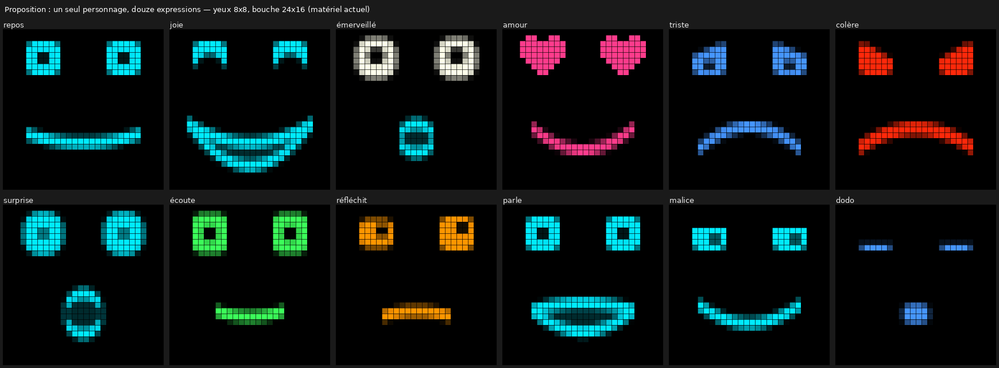
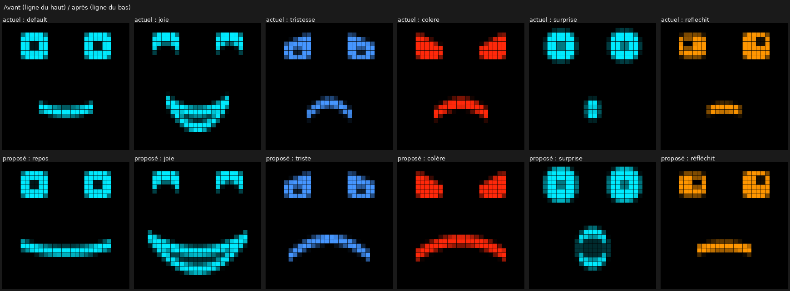
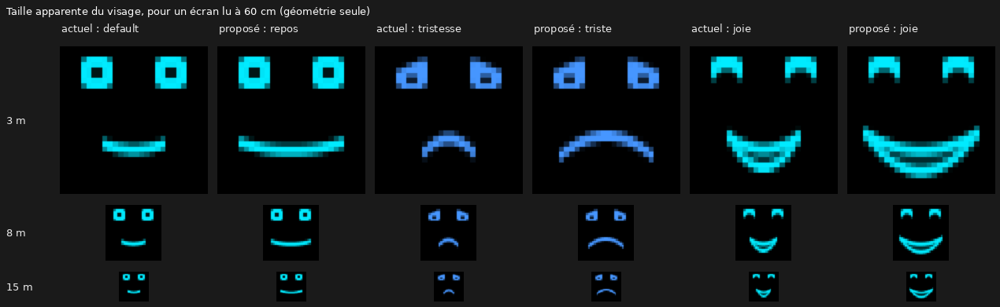
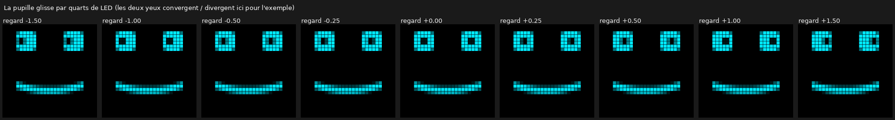
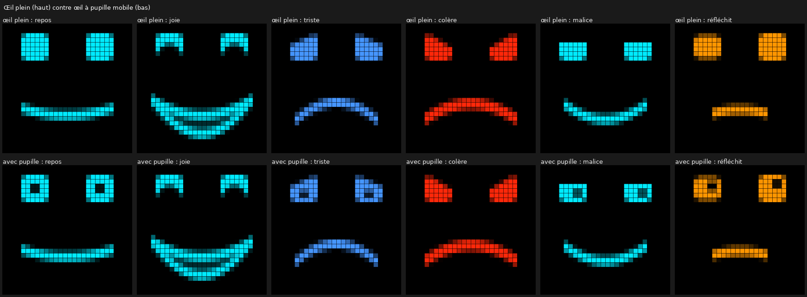
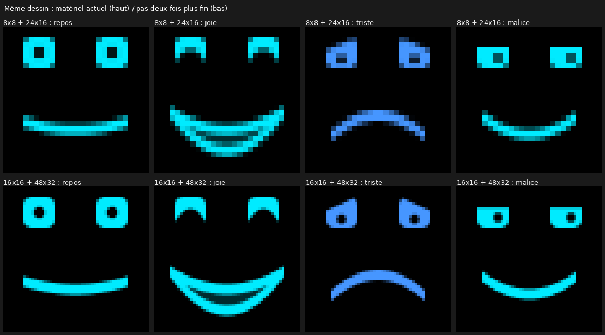

# Étude — le visage de Didier (dessin, animation, lumière, matériel)

**Statut : DÉCIDÉ le 22/11/2026 (David) — les 4 questions du §8 tranchées : pupille mobile, cyan, `default` = repos néon, feu vert V0 bis puis V1. Premier geste fait le même jour : lot « V1-images » (§10).** Demande de
David : « une étude complète sur le design du visage, avec des propositions ».
Modèle : Fable 5.2 (étude), trois agents de recherche web, une relecture contradictoire
(20 constats dont 2 bloquants, tous intégrés ; cette version est la réécriture).

Les planches sortent de [`visage/maquette_visage.py`](visage/maquette_visage.py), une maquette
qui dessine au format réel des matrices (yeux 8×8, bouche 24×16). Ce n'est pas du code de robot.

## 0. En bref

Le visage actuel n'a pas un problème de dessin, il a un problème de **vie** et de **cohérence** :

- les expressions récentes (famille « néon ») sont bien dessinées et se lisent de loin ;
- mais le visage est un **diaporama** : rien ne se combine (regard, clignement, émotion et
  parole sont figés ensemble dans chaque animation), il ne cligne que dans 2 expressions sur
  27, la bouche qui parle tourne en boucle de 800 ms sans lien avec la voix, et on passe d'une
  émotion à l'autre par un saut ;
- deux personnages cohabitent : l'anneau jaune de 2023 et le néon de 2026. **Après chaque
  réplique, la conversation renvoie le visage sur l'ancien** (elle envoie `stop`, qui affiche
  `default`) ;
- la luminosité est réglée à 5 %. Personne n'a mesuré ce que ça donne dehors, de jour, là où
  Didier doit jouer fin février.

| | Proposition | Coût | Ce que ça change |
|---|---|---|---|
| **P1** | **Visage paramétrique** : une expression = une dizaine de nombres au lieu d'un jeu d'images ; transitions glissées | logiciel ; dessin en sim, **cadence à valider sur le Pi** | émotion, regard, clignement et parole se combinent |
| **P2** | **Vie au repos et bouche qui suit la voix** ; un état « écoute » | logiciel | Didier a l'air vivant même immobile ; le passant sait quand parler |
| **P3** | **Charte** : un personnage, une couleur d'identité, des règles de trait | décision de David | fin des deux visages |
| **P4** | **Lumière de jour** : mesurer d'abord, puis limiter le courant et nommer deux réglages | une séance au banc + logiciel | la seule inconnue qui peut rendre le visage invisible en rue |
| **P5** | Diffuseur à face noire | à n'ouvrir que si la mesure condamne le blanc | contraste au soleil, mais très gourmand en courant |

Écarté pour février : changer de matériel (§6). La raison est le calendrier, le courant et la
mécanique à refaire — pas la lisibilité, que je n'ai pas pu établir.

**Mon avis** : P1 + P2 sont le vrai sujet. Deux préalables sur du matériel réel passent avant
tout code : combien d'affichages par seconde le ruban supporte (§5, P1), et ce que donne le
visage de jour (lot V0). **V0 touche au rail 5 V du Pi qui pilote les roues : il ne se fait que
roues neutralisées** (§7). Quatre questions pour David au §8.

Animation de dix secondes (repos qui cligne et regarde, écoute, réfléchit, parle, joie) :
[`visage/vie-du-visage.gif`](visage/vie-du-visage.gif). La bouche y suit un volume simulé.

Les étiquettes des planches sont accentuées pour la lecture ; dans le robot les noms restent
ceux d'aujourd'hui, sans accent (§5, P1).

## 1. Ce que le visage doit faire

1. **Dire où en est la conversation.** Un passant doit savoir sans explication si Didier
   l'écoute, réfléchit ou parle. Le visage a `reflechit` et `parle`, pas d'« écoute ».
   (L'anneau de LED du micro ReSpeaker peut aussi montrer d'où vient la voix ;
   `hardware/overview.md` demande déjà qu'il ne contredise pas le visage.)
2. **Porter le personnage.** Didier est « amoureux de tout », a des lubies, et ses bugs sont
   de la matière de jeu : émerveillement, tendresse et malice plus souvent que colère.
3. **Faire des numéros.** Cœur arc-en-ciel, cerveau, lèvres, personnages : des gags ponctuels.

Contrainte de scène : public à 3-15 m, de jour, souvent de côté.

## 2. L'existant

### 2.1 Matériel

| Élément | Constat | Source |
|---|---|---|
| Yeux | deux matrices WS2812 8×8, chacune dans une nacelle de 100 mm sur une tige ; un servo par nacelle, qui tourne **de gauche à droite seulement** | `gaze_control.py`, photo `eye-motor.jpg`, STL `plans/tete/eyes` |
| Bouche | six matrices 8×8 = 24×16, sur un cylindre à pans qui tourne avec le cou | `image_mapping.py`, plan de refonte |
| Pans de la bouche | trois panneaux de 8 colonnes ; les pans de côté font environ 49° avec celui de face. **Vu de face, seules les 8 colonnes du centre sont de face** | STL `plans/tete/mouth`, photo `mouth.jpg` |
| Pas des LED | 8,1 mm en largeur, 8,35 mm en hauteur sur la bouche (arrondi à 8,4 dans les calculs) ; **non relevé pour les yeux** | grilles STL de la bouche |
| Diffuseur de la bouche | plastique blanc imprimé avec grille : pixels carrés nets | photo `mouth.jpg` |
| Diffuseur des yeux | face blanche épaisse, **sans grille visible** : pixels probablement plus flous | photo `eye-motor.jpg` |
| Ruban | 1000 LED déclarées sur un seul GPIO du Pi 4 : visage 0-511, corps 513-673 | `robot_config.py` |
| Luminosité | 0,05 (5 %), **un seul réglage pour tout le ruban**, non conservé au redémarrage | `lights.py`, `interfaces.md` |
| Alimentation | les LED sont sur le même 5 V que le Pi 4 de contrôle | `hardware/overview.md` |

Les cotes viennent des modèles 3D, pas d'une mesure sur le robot.

La bouche est donc un **bandeau enroulé** : un spectateur de côté voit « son » pan de face.
C'est un atout pour la rue et une règle de dessin : l'essentiel au centre, les côtés prolongent.

⚠️ Dans la sim, l'URDF fait pivoter les nacelles en tangage et les rattache au torse : l'aperçu
des yeux orientables y est faux. À corriger avant de juger un « regard qui suit » en sim.

### 2.2 Catalogue

37 expressions dans `data/json/expressions.json`, dont 10 mires ; 127 PNG (dont 124 au premier
niveau : 44 yeux, 80 bouches), 15 qu'aucune expression n'utilise.

- **2023, « anneau jaune »** : `default`, `speak`, `voila`, `bored`, `upgrade`… Œil = anneau
  à trou carré, bouche = trait ou rectangle rayé. C'est l'expression **par défaut**.
- **2026, « néon »** : `repos neon`, `joie`, `colere`, `tristesse`, `surprise`, `reflechit`,
  `parle`, `amour neon`. Mieux dessinée, une couleur par émotion.

La conversation envoie les émotions de la seconde famille (`performance.py` : `happy` → `joie`,
`disgust` → `glitch total`…), mais son retour au calme passe par `stop`, que `Face` traduit en
`default`. **Le visage change de personnage à chaque fin de réplique.**

Autre chemin à connaître : « parle » passe aussi par le sujet `animation`, dont la séquence
`sequences/didier/parle.json` remue au hasard les servos des yeux, le cou et les bras.

### 2.3 Moteur

`Face` (`didier_core/actions/face.py`) joue trois pistes d'images clés (œil gauche, œil droit,
bouche). Pas d'interpolation, pas de calques.

1. **Rien ne se combine.** Le regard existe (le trou de l'œil se décale dans une douzaine
   d'expressions) mais il est figé dans chaque animation : on ne peut pas le commander, ni
   l'ajouter à une émotion. Même chose pour le clignement.
2. **Peu de vie au repos.** `default` décale sa bouche de 3 LED et ses yeux d'un cran, sur un
   cycle de 5 s. Deux expressions clignent (`repos neon`, `repos glitch`).
3. **La parole est une boucle** de quatre bouches en 800 ms. La clé `follow audio` est admise
   dans les données, aucun comportement n'y est attaché.
4. **Les changements sont des sauts.**

Ce moteur est sain (testé, rechargement à chaud, aperçu sim). Il est fait pour des numéros
dessinés, pas pour un visage vivant.

### 2.4 Le ruban est partagé, et lent

Trouvé à la relecture, décisif pour la suite :

- chaque affichage (`show()`) émet les 1000 LED et **bloque environ 31 ms**
  (`fast_neopixel.py` : attente de fin de trame indispensable, incident du 13/07) ;
- le corps anime déjà le même ruban environ 10 fois par seconde (`chase me`) ;
- visage et corps sont traités l'un après l'autre dans le même nœud, toutes les 50 ms.

Un visage redessiné 20 fois par seconde **en plus** du corps demanderait jusqu'à deux affichages
de 31 ms par tranche de 50 ms : ça ne tient pas. La sim ne le verra jamais (son ruban est factice).

### 2.5 Lumière et courant

Calculé sur les PNG : pour chaque piste, l'image la plus chargée, à 20 mA par canal de couleur
à pleine puissance (valeur de fiche technique, non vérifiée sur ces matrices). C'est un pire cas.

| Expression | LED allumées | Courant à 100 % | à 5 % |
|---|---|---|---|
| `default` | 92 | 3,2 A | 0,16 A |
| `repos neon` | 124 | 4,3 A | 0,21 A |
| `tristesse` | 111 | 2,6 A | 0,13 A |
| `joie` | 146 | 5,7 A | 0,28 A |
| `colere` | 186 | 7,4 A | 0,37 A |
| `amour neon` | 291 | 10,0 A | 0,50 A |

Non comptés : le ruban du corps (160 LED) et le courant de repos des 1000 LED éteintes, inconnu
et à mesurer.

Le 5 V de ces LED est celui du Pi 4 de contrôle. `hardware/overview.md` est explicite : une
chute de ce rail redémarre le Pi 4, donc le nœud des roues, alors que la carte servo garde sa
dernière consigne — **les roues continueraient de tourner**, et le garde-fou matériel n'existe
pas encore. Le fusible de 10 A prévu (plan de refonte, D8) n'est pas posé, et ne protégerait
pas de ça. **Monter la luminosité du visage est donc une question de sécurité des roues**, pas
seulement de fusible.

Enfin, la lumière perçue dépend surtout du **vert** (luminance = 0,21 R + 0,72 V + 0,07 B).
`tristesse` est en bleu presque pur (0, 80, 255) : la moins lumineuse du catalogue.

## 3. Ce que dit la recherche

Rapports bruts dans [`visage/sources/`](visage/sources/). « Lu » = page ouverte par l'agent ;
« non vérifié » = vu dans un résumé de moteur de recherche. Les citations sont des paraphrases
d'agent, à rouvrir avant de les reprendre ailleurs.

**Quels traits comptent** (Kalegina et al., HRI 2018, lu : 17 visages d'écran, 50 participants,
images fixes) :

- retirer la **bouche** ou les **pupilles** rend le visage nettement moins sympathique et moins
  digne de confiance (« yeux morts », « robot sans âme », « surveillance ») ;
- des **paupières** dessinées qui coupent le haut de l'œil donnent un air « sournois » ;
- sourcils : plus mûr, plus intelligent ; joues : plus enfantin, plus féminin ;
- aucun ajout ne rend le visage plus aimé que le visage de base.
- Limite dite par les auteurs : images fixes ; un œil sans pupille qui cligne pourrait ne pas
  paraître « sans âme ».

**L'école inverse.** Cozmo (Anki) a des yeux sans pupille : d'après son cofondateur, les
pupilles le rendaient trop humain, et les animateurs ont retravaillé taille et proportion des
yeux (The Robot Report 2016, lu ; le retrait des pupilles lui-même est décrit par une page non
ouverte). Anki compense par l'animation : 536 animations selon son décompte (TechCrunch 2016,
lu). Son successeur Vector pilote ses yeux par **quelques paramètres interpolés** et environ
deux douzaines de préréglages, estimation de l'auteur d'une documentation communautaire (lue).
C'est l'architecture de P1.

**Yeux seuls ou visage entier** (Mishra et al. 2024, lu ; chiffres agrégés sur un visage humain
et deux visages de robot projetés) : 64 % d'émotions reconnues avec le visage complet, 51 % avec
les yeux seuls. La bouche aide surtout pour la joie, la tristesse et le neutre. Peur et surprise
se confondent, dégoût et colère aussi.

**Couleur et lumière** (Feldmaier et al. 2016, lu, 47 LED) : un affichage lumineux transmet
bien l'énergie (calme ou agité), mal le plaisir. La couleur seule est subjective et culturelle.

**Rythmes** (non vérifiés, points de départ) : 17 clignements par minute au repos, 26 en
parlant (Bentivoglio 1997) ; durée d'un clignement de 100 à 400 ms selon des sources qui se
contredisent ; un robot qui détourne le regard par moments paraît réfléchir (Andrist et al.
2014, résumé lu, sans chiffres).

**Bouche** (non vérifié, et mesuré sur des têtes 3D réalistes, pas sur des personnages
stylisés) : une bouche qui articule trop est préférée à une qui articule trop peu, et une
intensité juste compte plus qu'une synchronisation exacte. Un projet de visage à matrices LED
(ProtOpenSource, lu) se contente de 5 états de bouche avec un micro.

**Bibliothèque** : FluxGarage RoboEyes (lu, GPL-3.0) fait des yeux en rectangles arrondis avec
humeurs, clignement et regard, pour petits écrans Arduino. Non réutilisable ici (C++ pour
microcontrôleur, licence, pas de bouche), mais le modèle est le même.

**Ce que la recherche ne dit pas** : rien sur des yeux en matrice 8×8, rien sur la lisibilité
d'un visage LED à 10 m en plein jour. Les principes de masque et de marionnette n'ont pas été
sourcés : je ne les invoque pas.

## 4. Lisibilité : distance, jour

### 4.1 Distance

Géométrie seule, avec le pas de la bouche :

| Distance | Une LED (8,4 mm) | Une matrice d'œil (≈ 67 mm) | La bouche (134 mm de haut) |
|---|---|---|---|
| 3 m | 9,6′ | 1,3° | 2,6° |
| 8 m | 3,6′ | 29′ | 58′ |
| 15 m | 1,9′ | 15′ | 31′ |

(′ = minute d'arc.) Je n'ai **pas de seuil perceptif sourcé** pour dire à quelle distance un
détail cesse de se lire. Les règles de fabricants d'afficheurs vont de 7,7 m (Daktronics,
« distance optimale », lu) à 25 m (non vérifié) pour ce pas, et se contredisent. Seule une photo
à distance tranchera.

Ce que cette planche montre honnêtement : **à 15 m, les dessins actuels de la famille néon se
lisent aussi bien que les miens**. Le gain de la proposition n'est pas dans l'image fixe.

### 4.2 Jour

Lu : un écran d'intérieur fait 350 à 500 cd/m², un affichage côté rue en demande 8 à 12 fois
plus (Samsung). Aucune mesure publiée de la luminance d'une matrice WS2812 n'a été trouvée.

Ordre de grandeur calculé, **hypothèse et non mesure** : avec les intensités de fiche technique
(vert 1,1 à 1,4 cd, bleu 0,2 à 0,4 cd à 20 mA, non vérifié) rapportées à une case de 8,4 mm, une
zone cyan ferait 18 000 à 25 000 cd/m² à 100 % avant diffuseur, donc environ 1 000 à 5 %. La
perte du diffuseur blanc imprimé est inconnue. Si l'ordre de grandeur est bon, 5 % est un
réglage d'intérieur, et il faudrait monter nettement pour la rue.

Le diffuseur blanc renvoie la lumière ambiante : au soleil le « noir » du visage devient gris
clair. Un diffuseur à face noire corrige ça (argument de vendeur, Adafruit, lu), mais les
plaques de ce type ne laisseraient passer que 13 à 18 % de la lumière (non vérifié). Avec le
calcul ci-dessus cela donne 2 400 à 4 600 cd/m² **à 100 %** : le bas de la cible, à un courant
que le rail ne peut pas fournir aujourd'hui.

## 5. Propositions

### P1 — Visage paramétrique

Une expression devient un réglage d'une dizaine de nombres :

- **œil** : largeur, hauteur, arrondi, paupière du haut (ouverture, pente), paupière du bas
  (ouverture, bombé), pupille (taille, position), couleur ;
- **bouche** : largeur, courbure, ouverture, arrondi en « o », couleur.

1. **Calques.** Expression de fond + regard + clignement + ouverture de bouche s'additionnent.
2. **Transitions.** Passer de « repos » à « joie » = faire glisser les nombres en 250 ms.
3. **Quart de pixel.** Un bord qui tombe au milieu d'une LED l'allume à moitié :

   Deux réserves : à 5 % il ne reste qu'une douzaine de niveaux par couleur, les demi-teintes
   s'écrasent ; et le diffuseur des yeux, sans grille, floute peut-être déjà tout. À voir sur
   le robot.

**Pupille ou œil plein ?**

Je recommande **l'œil plein avec une pupille sombre mobile**, qui disparaît quand les paupières
se ferment beaucoup (joie, colère, dodo). La recherche sur les visages d'écran pénalise l'absence
de pupille ; la pupille donne un regard vers le haut et le bas et des micro-mouvements que les
servos des nacelles ne font pas ; c'est la continuité de l'anneau actuel. Paupières **ouvertes au
repos**. Cozmo prouve que l'œil plein marche aussi, avec beaucoup d'animation : c'est un choix
de personnage, donc de David.

**Contrats — ce qui ne doit pas bouger :**

- les noms restent en minuscules sans accent (règle `MOTIF_NOM_ENTREE` de `theatre_contrats`) et
  **les noms existants sont gardés** : `joie`, `colere`, `tristesse`, `surprise`, `reflechit`,
  `parle`, `amour neon`, `repos neon`. Nouveaux : `ecoute`, `emerveille`, `malice`, `dodo` ;
- les préréglages vivent **dans `expressions.json`** (une entrée à paramètres au lieu de pistes
  d'images), sinon ils disparaissent de la télécommande et de la page scène, qui construisent
  leur catalogue sur ce fichier ;
- `default` devient le repos néon : c'est ce qui supprime le changement de personnage en fin de
  réplique, sans toucher à la conversation ;
- `glitch total` (réponse à `disgust`) reste un numéro dessiné : un bug joué, c'est le personnage.

**Préalable sur le Pi, avant la spec** : mesurer la cadence réelle du ruban, puis passer à
**un seul affichage par tranche de 50 ms, commun au visage et au corps**. Piste de gain à
vérifier : déclarer 674 LED au lieu de 1000 (le dernier indice utilisé est 673) raccourcit
chaque trame d'un tiers.

**Ce que P1 supprime, à terme** : les PNG des expressions remplacées, après validation de chaque
remplaçante par David. Le lecteur d'images clés reste pour les numéros et les mires.

### P2 — Vie au repos, bouche qui suit la voix

Sur les expressions paramétriques seulement (jamais sur une mire ni un numéro) :

- **clignement** : toutes les 3 à 4 s au repos, plus souvent en parlant ; fermeture vive,
  réouverture plus lente ;
- **petits déplacements du regard** toutes les 1 à 2 s ;
- **regard qui suit** : quand le suivi a une cible, la pupille part vers elle avant la nacelle,
  plus lente (choix de mise en scène, non sourcé). Suppose de régler d'abord le conflit avec la
  séquence `parle.json`, qui agite les nacelles au hasard ;
- **respiration** : variation lente et faible de l'intensité **des pixels du visage**, pas du
  réglage de luminosité du ruban, qui est commun au corps et à la télécommande.

**Bouche**, en deux marches :

1. **syllabes simulées** : tant que l'état est `parle`, l'ouverture suit un rythme irrégulier
   de 3 à 5 battements par seconde. Aucun lien avec le son, et déjà mieux qu'une boucle ;
2. **volume réel** : la machine qui joue la voix publie son volume, le visage ouvre en
   proportion. Le son part du Pi vision, le visage est sur le Pi robot : retard à caler. À
   n'ouvrir que si la marche 1 ne suffit pas.

**États de conversation** : `ecoute` (yeux agrandis, bouche petite, vert), `reflechit` (regard
en haut de côté, un œil plus petit, ambre), `parle` (cyan, bouche active). L'ajout de `ecoute`
touche `didier_vision`.

### P3 — Charte

1. **Un seul personnage** : mêmes yeux, même bouche partout.
2. **Une couleur d'identité : le cyan.** Déjà celle de `repos neon` et `parle`, complémentaire
   de l'orange du corps, et riche en vert.
3. **La couleur est un accent, pas le message.** L'émotion se lit en forme ; la couleur
   confirme. Accents : rose (amour), rouge (colère), bleu clair (triste), blanc chaud
   (émerveillé), vert (écoute), ambre (réflexion).
4. **Toute couleur contient du vert.** Le « triste » passe de (0, 80, 255) à (70, 150, 255).
5. **Trait de 2 LED au moins**, formes pleines plutôt que contours : une marge de prudence pour
   la distance et le jour, à confirmer par la mesure.
6. **La bouche occupe la largeur** : 16 à 22 colonnes sur 24 pour les expressions courantes (David, 22/11 : « la largeur possible de la bouche est moins utilisée » ; remplace la règle des 12 colonnes du centre). Les pans de côté prolongent le dessin.
7. **Budget de lumière** : une expression de fond sous 160 LED allumées. Les douze proposées
   font 40 à 160 LED, soit 0,8 à 4,8 A à 100 %, contre 2,6 à 10 A aujourd'hui.
8. **Les numéros restent des numéros**, appelés exprès.

Émotions : repos, joie, émerveillé, amour, triste, colère, surprise, malice, dodo, plus les
trois états de conversation. Pas de peur ni de dégoût dessinés à part.

### P4 — Lumière de jour

1. **Mesurer** (lot V0), roues neutralisées.
2. **Limiteur de courant** : avant chaque affichage, estimer le courant de l'image (visage **et**
   corps) et réduire l'intensité des pixels si elle dépasse le budget. Budget = une valeur du
   cahier de câblage, fixée avec la refonte électrique. Sans limiteur, pas de montée de luminosité.
3. **Deux réglages nommés**, « intérieur » et « rue de jour », **conservés au redémarrage**
   (aujourd'hui la luminosité retombe à 5 %).

### P5 — Diffuseur à face noire

D'après le calcul du §4.2, il demanderait presque toute la puissance des LED. **Je ne le propose
donc pas en l'état.** À rouvrir seulement si V0 montre que le blanc ne passe pas de jour, et
après la refonte électrique (rail des LED séparé de celui du Pi). Repère de prix lu : 5,95 $ la
plaque 260 × 130 mm chez Adafruit (réf. 4749, en rupture le 22/11).

## 6. Matériel plus fin : pas pour février

À pas deux fois plus fin les courbes sont plus douces ; de près c'est nettement plus joli. Je ne
sais pas dire à partir de quelle distance la différence cesse de compter.

| Option | Pour | Contre | Prix lu |
|---|---|---|---|
| WS2812 au pas de 4 mm | même pilotage, même logiciel | **aucune référence trouvée** (la 16×16 flexible d'Adafruit fait 160 mm, donc un pas de 10 mm, plus gros que l'actuel) ; 4 fois plus de LED, de courant et de temps de trame | — |
| Panneaux HUB75 64×32 P3 | très fin, bon marché | modèles d'intérieur, luminance non lue ; nappe de données parallèle **à travers le cou qui tourne** ; autre bibliothèque de pilotage | 22,99 à 25,99 $ (Waveshare), 44,95 $ (Adafruit 2279) |
| Écrans ronds pour les yeux | yeux réalistes | 33 mm de diamètre ; luminance non lue ; **change le personnage** | 16,20 £ (non vérifié) |

Verdict : **non pour février**, pour trois raisons qui ne dépendent pas de la perception : le
calendrier (cap fiabilité et autonomie), le rail 5 V qui ne supporte déjà pas l'existant à
pleine puissance, et la mécanique à refaire (nacelles, cylindre, passage du cou). Le visage
paramétrique se dessine tel quel sur une matrice plus fine le jour où on en voudra.

Écartés aussi : sourcils mécaniques (un servo de plus près du public) ; reprendre RoboEyes.

## 7. Plan

| Lot | Contenu | Où | Vérification | Modèle |
|---|---|---|---|---|
| **V0** | Mesure de jour, **roues neutralisées** (voir ci-dessous) | robot ou banc témoin, dehors | photos + tableau dans cette étude | Opus |
| **V0 bis** | Cadence réelle du ruban : durée d'un affichage, effet de 674 LED au lieu de 1000, un seul affichage par tranche | Pi 4, banc | chiffres dans cette étude | Opus |
| **V1** | Spec, puis module pur de rendu paramétrique + préréglages dans `expressions.json`, branché sous `Face` ; `default` = repos néon | `didier_core`, sim | tests à valeur gravée ; aperçu `face_sim_node` ; planche validée par David | spec Fable, code Opus |
| **V2** | Vie au repos, transitions, syllabes simulées, état `ecoute` | `didier_core`, `didier_vision`, sim puis Pi | épreuve sim : un état par tour de parole ; **nombre d'affichages par seconde tenu sur le Pi, corps animé** | Opus |
| **V3** | Limiteur de courant, réglages nommés et conservés | `didier_core` | test : aucune image au-dessus du budget ; mesure réelle | Opus |
| **V5** | Retrait des expressions remplacées et des PNG inutilisés | `data/`, tests | suites `didier_core` vertes : `test_visuels_png.py` et `test_rechargement.py` gravent des noms de PNG, dont des orphelins, à mettre à jour dans le même lot | Opus |

**Protocole V0, sécurité d'abord.** Le rail des LED est celui du Pi qui commande les roues.

- puissance moteurs coupée ou roues hors sol, règles de `legacy/dadou_robot_ros/CLAUDE.md` ;
- paliers 5, 10, 15, 20, 30 %, en commençant par l'expression la moins chargée ; pas de
  `colere` (son éclair fait un saut de courant) ni de `amour neon` au-dessus de 20 % ;
- à chaque palier : courant du rail 5 V, tension aux bornes du Pi, `vcgencmd get_throttled` ;
  **arrêt au premier signe de sous-tension** ;
- relever aussi le courant ruban éteint ;
- photos à 3, 8 et 15 m, à l'ombre et au soleil, exposition manuelle (l'auto-exposition a déjà
  trompé une calibration) ; même protocole pour la bouche et pour un œil.

V1 peut s'écrire sans attendre V0. V0 bis passe **avant la spec V1** ; V0 avant V3. La sim doit
marcher à la fin de chaque lot.

À surveiller : les séquences enregistrées appellent des expressions par leur nom (aucun nom ne
disparaît sans remplaçant) ; l'arbitrage visage/tête (`etude-arbitrage-actionneurs.md`) reste la
règle — la vie au repos est un calque du visage, pas une source de plus.

## 8. Questions pour David

1. **Pupille** : œil plein avec pupille mobile (ma recommandation), ou œil plein sans pupille ?
2. **Couleur** : cyan comme couleur de Didier, les autres en accents ?
3. **L'ancien visage jaune** : `default` devient le repos néon ?
4. **Feu vert** pour V0 bis puis V1, et une date pour V0 ?

## 9. Limites

- Aucune mesure sur le robot : ni luminance, ni courant, ni cadence, ni lisibilité de jour.
- Pas de seuil de lisibilité sourcé : toutes les affirmations de distance sont géométriques.
- La maquette juge la forme, pas le diffuseur, le halo des LED la nuit ni le soleil ; ses
  proportions ne sont pas celles du robot (yeux bien plus écartés et plus hauts).
- Le pas et le diffuseur des yeux n'ont pas été relevés.
- Les rythmes (clignement, parole) viennent de résumés non ouverts.
- Les dessins sont un point de départ réglable : c'est David qui dira si « malice » ou
  « triste » sont justes.

## 10. Lot V1-images (22/11) — le nouveau visage en images, sans changer le moteur

En attendant le moteur paramétrique, le visage v2 est posé **dans les données** :
[`visage/generer_visuels.py`](visage/generer_visuels.py) dessine chaque image avec la maquette et
réécrit les pistes de 13 expressions dans `data/json/expressions.json`. Rejouable à l'identique.

- **Remplacées, noms gardés** : `default` (devient le repos cyan : fin du visage jaune après
  chaque réplique), `repos neon`, `joie`, `colere`, `tristesse`, `surprise`, `reflechit`,
  `parle`, `amour neon`. Conversation, télécommande, séquences et page scène inchangées.
- **Nouvelles** : `ecoute`, `emerveille`, `malice`, `dodo` — branchées sur rien pour l'instant.
- **Clignements** : repos (simple puis double), tristesse (lent), écoute ; l'œil fermé est un
  trait de 2 LED, jamais du noir.
- **Images** : 89 PNG `v2-*` ajoutés ; les anciens restent (retrait = V5).
- **Supprime** : rien.

Planche image par image : [`visage/planche-v2.png`](visage/planche-v2.png).
