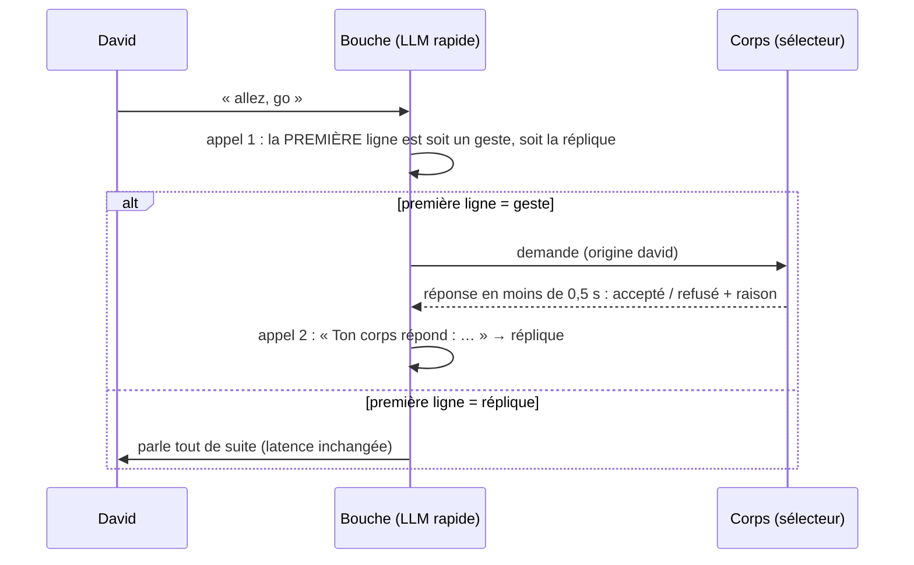

# Spec S2 — le corps raconte (27/11/2026)

Lot S2 de l'étude d'assainissement (`docs/etudes/etude-assainissement.md` §4 règle 3, §8 bis,
§8 ter), après S1 (`docs/spec-S1-ordres-propositions.md`, fusionné le 26/11). Sim seule
(domaine 43). Écrite en Fable 5.2 ; exécution en Opus.

## 0. En une phrase

La bouche ne dit plus rien du corps qu'elle n'ait lu : **un seul état du corps**, écrit par le
sélecteur, et pour toute demande de mouvement elle **demande d'abord, attend la réponse du
corps, puis parle**. Critère de sortie : moins de 2 mensonges sur 60 au banc de cohérence.

## 1. Ce que ça corrige (vécu)

| Vécu | Séance | Corrigé par |
|---|---|---|
| « Ça y est, je fonce vers la grue ! » alors que le go venait d'être refusé | 26/11 | §3 (parler après le corps) |
| « Allez, en route ! » hors séance, sans bouger | 25/11 | §3 |
| « La flaque est derrière moi » : faux | 26/11 | §2 (`ici`) |
| il dit avoir peur de la flaque puis roule dessus | 26/11 | §2 (`marche`, `ici`) et consigne §4 ; le contournement lui-même est S4 |
| il parle de la grue alors qu'il est au banc | 24/11 | §2 (`ici`) |
| « regarde l'éléphant à droite » : pivot fixe de −90° | 25/11 | §5 (se tourner vers) |
| au banc, « il n'a pas cadré le banc » | 26/11 | §5 (finir face à l'objet) |
| demander de bouger hors séance sans savoir pourquoi rien ne se passe | 24/11 | §2 (`cause`), décision 4 du §8.1 |

## 2. Le contrat `corps/etat`

Topic **latché** (TRANSIENT_LOCAL des deux côtés, profondeur 1), `StringTime` JSON, écrit par
**le sélecteur seul** (`didier_jeu`), republié à chaque changement et au plus tard toutes les
2 s. Constantes et encodeur/décodeur dans `theatre_contrats` (module `corps_etat`, pur,
testé) ; documenté dans `docs/interfaces.md`.

| Champ | Valeurs | Source (déjà dans le sélecteur sauf mention) |
|---|---|---|
| `marche` | `en_route` · `arrete` · `geste` · `empeche` | `route_state`, engagement en cours |
| `cause` | `david_stop_voix` · `david_stop_console` · `david_route_off` · `didier_lubie` · `didier_pause` · `didier_stop` · `geste_fini` · `corps_sur_verrou` · `corps_sur_zone` · `seance_non_lancee` · `aucune` | verrou (S1), reprise armée, **`corps_sur/etat`** (nouvel abonnement), **`rehearsal/state`** (abonnement S1) |
| `qui_relance` | `david_console` · `david` · `didier` · `personne` | genre du verrou ; `personne` = réarmer d'abord |
| `repart_dans_s` | nombre ou `null` | reprise armée (silence restant) |
| `geste` | `null` ou `{demande, etat: en_cours\|arrive\|abandonne\|refuse, raison, parcouru_m}` | dernier geste, 60 s de mémoire |
| `ici` | `{sur: <objet ou null>, proches: [{nom, cote, distance_m}] (2 au plus)}` | tableau des objets (`scene/objets`) : `sur` = objet à moins de son emprise + 0,5 m ; `cote` = devant, gauche, droite, **derrière** |
| `phrase` | une à trois phrases en français, **300 caractères au plus** | composée par le module pur, textes gravés en test |

Exemples de `phrase` (gravés) :
- « Tu roules sur ta route. Tu traverses : la flaque. Devant toi à 6 m : le banc. »
- « Tu es arrêté : David t'a arrêté à la console. Seul son bouton GO te relance. Tu n'as pas bougé. »
- « Tu es arrêté devant le banc : c'est toi qui t'es arrêté. Tu repars dans 12 s si personne ne parle. »
- « Tu ne peux pas bouger : la séance n'est pas lancée. David peut la démarrer sur la page. »
- « Ton dernier geste (aller voir la grue) a été abandonné après 0,0 m : ton corps est verrouillé par sécurité. »

Règles : jamais deux causes ; `corps_sur_*` passe avant tout le reste ; état inconnu (source
muette plus de 3 s) → `marche: empeche`, `cause: aucune`, phrase « Tu ne sais pas où en est ton
corps. » (jamais un état deviné).

**Lecteurs.** La bouche (§3), la réflexion (elle remplace ses abonnements `route_state`,
vitesse et POI par ce topic), la page scène (une ligne « Corps : … » en tête de la colonne
Jeu = `phrase`), le journal du jeu (un événement `corps_etat` à chaque changement de `marche`
ou de `cause` : c'est lui qui dit « il a décidé » ou « David a arrêté »).

**Ce que ça supprime.** Dans la bouche : `SituationBoard.set_route`, `set_speed`, `set_poi`,
`moving()` et leurs abonnements ; la section « perception du corps » du tableau de situation est
remplacée par `phrase`. La personne vue reste dans le tableau.

## 3. La bouche parle après le corps

Aujourd'hui le LLM écrit sa réplique puis un JSON de fin ; la demande part **après** les
phrases. Désormais, pour un tour humain :

- **Format.** Le prompt demande : si la demande de David appelle un geste, la **première ligne**
  est `GESTE {json}` (mêmes clés qu'aujourd'hui) et **rien d'autre** ; sinon la réplique, comme
  aujourd'hui. Le flux est coupé dès la fin de cette ligne (séquence d'arrêt). Le JSON de fin
  ne porte plus aucune clé de mouvement (émotion, regard, `reflechir` restent).
- **Réponse du corps à TOUTE demande.** Le sélecteur répond sur `rehearsal/chat_move_reply` à
  chaque demande d'origine `david`, `go` et `stop` compris (aujourd'hui : gestes seulement) :
  `accepted`, ou `dropped` + raison (`arrete` avec le genre du verrou, `hors_seance`,
  `pas_ici`, `hors_atteinte`, `sans_superviseur`, `corps_sur`). Délai garde : **0,5 s** ; sans
  réponse → raison `sans_reponse`.
- **Appel 2.** Message système court : la demande de David, le geste demandé, la réponse du
  corps en clair (table de phrases gravées, une par raison), puis `corps/etat.phrase` à jour.
  Consigne : « annonce une intention ou raconte un résultat ; ne dis jamais d'un mouvement
  qu'il est fait s'il n'est pas dans cet état ».
- **Mot d'arrêt.** Inchangé : `stop` `david` part à la fin du STT, avant tout appel LLM.
- **Pendant l'attente** (appel 1 + corps + appel 2) : le visage « réfléchit » et les bips
  existants ; aucune phrase de remplissage.
- **Tour spontané** : aucun geste possible (S1) ; il reçoit `corps/etat.phrase` comme les autres.
- **Fin de geste** (`_serve_continuation`) : garde son mécanisme, mais le texte donné au LLM
  vient de `corps/etat.geste` (un seul endroit qui dit ce qui s'est passé).
- **Prompt** (`personas.MOVE_TEMPLATE`) : réécrit. Supprimer « ou quand TOI tu décides que ta
  lubie est finie » : la bouche transmet ce que David demande, elle ne décide pas (§8 bis).

**Latence.** Mesurée avant et après par le banc (premier mot) : tour sans geste, inchangée à
±0,1 s ; tour avec geste, au plus **+1,0 s** (accepté par David le 24/11 : « ça peut mettre un
peu plus de temps si ça fait gagner de la cohérence »). Chiffres dans la PR.

## 4. Consignes de cohérence données à la bouche

Trois lignes, dans le prompt, à côté de `phrase` :
1. Ce que tu dis de ton corps et de l'endroit où tu es vient **uniquement** de « Ton corps ».
2. Tu peux broder sur ce que tu ressens (« ce banc m'appelle »), jamais sur ce que tu fais.
3. Si tu roules, tu continues de rouler : ne dis pas que tu t'arrêtes, que tu contournes ou
   que tu recules si « Ton corps » ne le dit pas.

## 5. Deux gestes d'orientation (lot S2c)

- **Se tourner vers un objet.** Nouvelle demande `{"cmd": "tourner_vers", "objet": <nom>}`
  (clé LLM `"tourner_vers": "<nom exact>"`). Le régisseur calcule l'angle depuis la pose et la
  position de l'objet (tableau des objets, mêmes règles d'atteinte que `aller_voir` pour la
  résolution du nom) et exécute un pivot **par le chemin existant de `tourner`** (mêmes bornes,
  même corps sûr). Objet inconnu ou sans position : refus dit. Le prompt indique : « pour
  regarder un objet nommé, utilise `tourner_vers`, jamais `tourner` avec un angle deviné ».
- ~~**Finir face à l'objet.**~~ **SANS OBJET (28/11, vérifié dans le code et les journaux
  du 26/11).** `aller_voir` et `tour_de` se terminent DÉJÀ par un pivot face à la cible :
  `goto.py`, phase `FACE`, tolérance `heading_tol_rad` = 0,1 rad (±6°), plus serré que les
  ±10° demandés ici. Le diagnostic de cette ligne était faux.

  **Le vrai défaut du « banc pas cadré » (séance du 26/11)** : Didier ne s'était pas *fait*
  aller voir le banc, il s'est arrêté DE LUI-MÊME dessus par une **lubie** (`poi_enter` →
  `arret_didier`). Dans ce chemin, le sélecteur ne tournait que sa **tête** (sortie `look`),
  et la caméra est fixée au **buste** : il parlait au banc de profil.

  **Ce qui est fait (corrigé après la relecture adverse du 28/11).** La première version
  envoyait « stop » puis un `tourner_vers` en régime « sur place » (qui ne levait pas
  l'arrêt) : `route_driver` tient tout pivot à facteur de vitesse 0 (`held`), donc **rien ne
  tournait**, puis le pivot retenu partait au « go » de la reprise et Didier restait planté
  (la reprise exige `arrived` ou `off`). Le régime « sur place » est **supprimé**. Désormais :
  - l'**arrêt de la lubie EST le pivot** : un `tourner_vers` d'origine « didier », manœuvre
    ordinaire acceptée exactement comme `tourner` (la route s'interrompt, Didier pivote, finit
    `arrived` à l'arrêt face à l'objet). Pas de « stop » avant ;
  - **repli** sur l'arrêt d'avant S2c (« stop » « didier ») si l'objet n'est pas situé dans le
    tableau, si le régisseur refuse le pivot (`deja_face`, `no_pose`, `trop_pres`, …) ou s'il
    ne répond pas en `durees_s.deplacement_accuse` (3 s ; la lubie ne finit pas avant) ;
  - le pivot passe par les **gardes d'un déplacement d'initiative** (superviseur absent en
    mode exigeant, fatigue, verrou de David) : refusé, c'est le « stop » d'avant S2c ;
  - **la reprise d'une lubie attend la fin du pivot** (`route_state` « goto ») : un « go »
    pendant une manœuvre est sans effet au régisseur (« deja_en_marche »). Elle part à
    l'arrivée, où le régisseur la prend en « rejoin » ;
  - **aucun « go » n'est perdu pendant le pivot** (2e relecture, 28/11) : le régisseur
    RETIENT un « go » « deja_en_marche » reçu pendant le pivot d'une lubie — go de David
    (console ou voix), ou go de reprise arrivé avant son propre `arrived` — et fait rejoin à
    l'issue du pivot (`arrived`, ou `off` après abandon). Tout stop, cancel, abort, commande
    `route` ou fin de séance venus après le font tomber. Sur un `off`, le rejoin exige
    l'issue CONNUE de la manœuvre (`route_goto_result`) et qu'elle soit un abandon de
    route_driver (`timeout`, `stalled`, `max_travel`, `off_track`, `too_far`) ; issue pas encore
    reçue : il l'attend ; autre issue (`route_off` d'un Route OFF de David dont la commande et
    la cause ne sont pas encore arrivées, `cancel`, inconnue) : le go tombe (3e relecture,
    28/11). Borné au pivot d'une lubie : ailleurs rien ne change ;
  - règles d'arrêt de David intactes : un stop de David pendant le pivot l'annule (`cancel`),
    sous son verrou le pivot est refusé `arret_de_david`, hors séance `hors_seance` ;
  - `tourner_vers` de David sous un arrêt : mêmes règles que `tourner` (il lève l'arrêt et
    pivote ; refusé « arrete » sous le verrou de la console, par le sélecteur) — plus jamais
    « accepted » sans mouvement ;
  - la régie ne calcule **jamais** sur un cap inventé : pose ou cap non finis, quaternion de
    l'odométrie nul ou de norme ≠ 1 à 0,01 près → « no_pose » ; objet à moins de 0,3 m du
    centre de Didier → « trop_pres » ; l'angle replié dans ]−180°, 180°] tient toujours dans
    la borne de 180° (pas de refus « hors bornes »).
  Épreuve de fumée : A1, verdict « S2c pivot de lubie » (18 contrôles au lieu de 17).

Ce lot touche le chemin des roues (régisseur → `route_driver`) : **Opus, relecture adverse
Fable avant fusion**, corps sûr inchangé, sim seule.

## 6. Découpage

| Lot | Contenu | Modèle | Fin |
|---|---|---|---|
| **S2a** | contrat `corps/etat` (module pur), écrivain dans le sélecteur, réponse à toute demande, ligne sur la page, journal | Opus | tests gravés (une phrase par cause) ; fumée ciblée A1 + objets |
| **S2b** | la bouche lit `corps/etat` ; premier appel « geste ou réplique », attente du corps, second appel ; prompt réécrit ; réflexion branchée ; suppressions du §2 | Opus | banc de cohérence rejoué ; latences mesurées ; fumée ciblée conversation |
| **S2c** | `tourner_vers`, finir face à l'objet | Opus + relecture Fable | épreuve sim : écart d'orientation < 10° sur 3 objets ; fumée ciblée chantiers + A1 + objets |

Ordre : S2a → S2b → S2c. Chaque lot : PR, CI verte, fumée ciblée (programme F1), doc dans le
même lot.

## 7. Tests exigés (valeurs gravées)

1. `corps_etat` : une phrase gravée par cause (11 causes) ; jamais deux causes ; `corps_sur`
   prioritaire ; source muette 3 s → état « inconnu » ; plafond de 300 caractères.
2. `ici` : objet sous Didier, objet derrière (côté `derriere`), aucun objet.
3. Sélecteur : une réponse pour chaque demande `david` (go, stop, pause, quatre gestes), raison
   exacte pour chaque refus de S1 (verrou console, voix, route ; hors séance ; hors d'atteinte).
4. Bouche : première ligne `GESTE …` → aucune phrase jouée avant la réponse du corps (ordre
   exact des événements) ; refus → le texte du second appel contient la phrase gravée du refus ;
   sans réponse en 0,5 s → `sans_reponse` ; première ligne = réplique → un seul appel.
5. Mot d'arrêt : toujours avant tout appel LLM (test existant, inchangé).
6. S2c : angle calculé gravé pour trois poses ; refus si l'objet n'a pas de position ;
   `arrive` après l'ajustement seulement.
7. Mutations de contrôle sur chaque point (le test doit rougir).

## 8. Critère de sortie

- **Banc de cohérence** (`packages/didier_vision/tools/banc_coherence.py`, 20 situations ×
  3) rejoué avec le protocole du §3 (condition nouvelle `--apres-corps`, le corps simulé
  renvoie la réponse prévue par la situation) : **moins de 2 mensonges sur 60** (10/60 en
  architecture cible le 25/11, 34/60 avant). Résultat brut dans `docs/seances/bancs/`.
  2 ou plus → on ne fusionne pas S2b ; on relit les cas un par un avant toute autre décision
  (étude §8 ter : si le banc échoue encore, la piste « un seul LLM » revient sur la table).
- **Latence** : chiffres du §3 tenus.
- **Séance de David, 10 min** (quand il donne un créneau) : STOP console puis « vas-y » →
  Didier dit qu'il ne peut pas, et pourquoi ; « regarde le banc » → il se tourne vers le banc ;
  « va voir l'éléphant » → il finit face à l'éléphant ; sur la flaque, il ne prétend pas
  l'éviter.

## 9. Ce que S2 ne fait pas

Contourner un objet de la route, s'arrêter de lui-même pour regarder, refuser avec humeur :
décisions de mouvement, donc régisseur LLM (S4). Ton du personnage (« cucul »), objet neuf,
insister, ne pas ressasser : réglages de parole, **après** S2. Bouton Séance en haut de la
page, Réarmer, visage temps 1 : S3.
