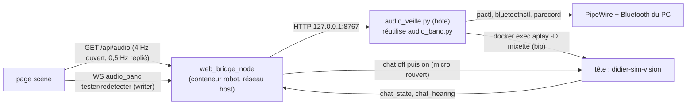

# didier_web

Package ROS 2 du robot Didier, autonome (aucun import `robot.*` ni `dadou_utils_ros`) :

| Exécutable | Nœud | Rôle |
|---|---|---|
| `web_bridge` | `web_bridge_node` | pont HTTP + WebSocket (console `/`, page scène `/scene`) — voir `docs/interfaces.md` §API web |
| — | `static/` | pages servies telles quelles, sans build : console `index.html` + `app.js`, scène `scene.html` + `scene.js` + `scene.css`, communs `commun.js` + `style.css` (ne pas y mettre de style propre à la scène) |
| `catalogue` | `catalogue_node` | **lot L1c** : publie le catalogue du robot et sa version |
| `data_edit` | `data_edit_node` | **lot L1d** : le SEUL écrivain des données du robot (désactivé par défaut) |
| `validation_sim` | `validation_sim_node` | **lot L1d-2**, SIM SEULEMENT : l'observateur de la porte sim, qui tamponne `json/validations-sim.json` |
| — | `lecture_donnees` | **lot L1d-3** : lecture pure des données éditables pour `GET /api/data` (liste + états de la porte sim, contenu + sha) ; **lot I0** : `bugs_joues()` pour `GET /api/bugs-joues` |
| — | `apercu_lumieres` | **lot I0** : modèle pur de ce que le ruban LED afficherait (aperçu des bandes de la page scène) |
| — | `panneau_audio` | **22/11** : verdict pur de l'onglet « Audio » de la page scène (`GET /api/audio`, sim seulement) |
| — | `panneau_appareils` | **lot L3a** (28/11) : jugement pur de la tuile « Appareils » de la page scène (une ligne par appareil du registre `theatre_contrats.appareils`, dans `state.appareils`) |

## `catalogue_node` (L1c)

Deux topics StringTime **latchés** (`qos.latched()` des deux côtés), noms dans
`theatre_contrats.topics` :

- `catalogue` : JSON `{faces, audios, animations, relays, robot_lights, visuals}`,
  construit par `web_catalog.build_catalog(json_dir)` (la même fonction sert
  `GET /api/catalog`). Reconstruit toutes les `refresh_period_s` (2 s) et
  **republié seulement s'il a changé** (`web_catalog.next_publication`).
- `deploy_sha` : chaîne JSON, le sha git écrit par Ansible dans `conf/DEPLOY_SHA`
  (`-dirty` si l'arbre rsyncé n'était pas propre) ou `"dev"` si le fichier est
  absent (sim). Lu une fois au démarrage.

Paramètres : `json_dir` (`/home/ros2_ws/json`), `deploy_sha_file` (`""` = `dev`),
`refresh_period_s` (`2.0`). Lancé par `robot_app.launch.py` (robot, et conteneur robot de la sim
depuis L2b), sous le namespace `/<ROBOT_NAME>/`.

Le pont web lit `deploy_sha` (`TOPICS_LECTURE`) pour le badge version ; il ne lit
PAS `catalogue` (la page garde `/api/catalog`).

Tests (hôte, sans ROS) : `packages/didier_core/test/unit/test_web_catalog.py`,
`test_catalogue_node.py` ; télécommande : `test_buttons_vs_catalogue.py`.
Preuve sim : `machines/sim/validate-catalogue.sh`.

## `data_edit_node` (L1d)

Écoute `data_edit` (demande), publie `data_edit_result` (verdict) — StringTime,
`qos.volatile(10)` des deux côtés, **jamais latché**. Mince : toute la logique est dans
`data_edit.traiter(brut, data_dir, enabled, maintenant)` (stdlib + `theatre_contrats`),
testée sans ROS. Contrat des données : `theatre_contrats.donnees` (jamais recopié ici).
Format des demandes, codes, ordre d'écriture : `docs/interfaces.md` § « Data editing through
the robot ».

Paramètres : `data_dir` (`/home/ros2_ws/src/robot`, enfants `json/` et `medias/` — même chemin
en sim et sur le Pi), `enabled` (`false`). Lancé TOUJOURS par `robot_app.launch.py` (variable
`DATA_EDIT`, la même sur le Pi et dans le conteneur robot de la sim) :
désactivé, il répond `edition_desactivee` à chaque demande. **Sur le vrai robot, l'activer est
une décision de David** (spec L1d, décision 10). Au démarrage, il vide ses temporaires
(`json/backup/.tmp/`, `medias/.tmp/`).

Ce qu'il écrit : la cible (séquence, entrée d'`expressions.json` / `robot_lights.json` /
`lights_base.json`, image), la sauvegarde `json/backup/<date>/…`, une ligne du journal
`json/backup/EDITIONS-EN-ATTENTE.jsonl` (avant l'écriture). Rien d'autre.

Tests (hôte) : `packages/didier_core/test/unit/test_data_edit.py` (octets et sha gravés, un cas
par code), `test_rechargement.py` ; contrat : `packages/theatre_contrats/test/test_donnees.py`.
Preuve sim : `machines/sim/validate-data-edit.sh` (13 épreuves, aussi jouée par la fumée).

## `validation_sim_node` (L1d-2, sim seulement)

L'observateur de la porte sim : il regarde ce qui se joue (`animation_state` latché, `face`,
`robot_lights`, `cmd_vel`), quel que soit le déclencheur, et pose le tampon `rejeu` du registre
`json/validations-sim.json` quand un élément a été joué jusqu'au bout sans incident ; il répond
aux demandes de validation des roues (`validation_sim_demande`). Verdicts sur `validation_sim`.
Critères et codes : `docs/interfaces.md` § « Sim gate ». Mince : la logique est dans
`validation_sim.Observateur` (pure, horloge injectée), qui **refuse de se construire hors domaine
43** — le registre ne s'écrit qu'en sim. Lancé par `complement_sim.launch.py` seul (conteneur robot de la sim), jamais sur le robot.

Paramètres : `data_dir` (`/home/ros2_ws/src/robot`), `journal` (`/home/ros2_ws/log/robot.log`,
le `LOGGING_FILE_NAME` de `didier_core`, égalité gravée). Écriture atomique (temporaire sous
`json/backup/.tmp/`), propriétaire de `json/` rendu, orphelines retirées à chaque écriture.
Ne lit pas `/rosout` (règle gravée : aucun abonnement à un nom absolu).

Tests (hôte) : `packages/didier_core/test/unit/test_validation_sim.py` (un tampon posé / refusé
par critère, bornes à leur valeur limite), `test_validations_sim.py` (le registre de `data/` est
complet). Par lot : `machines/sim/rejouer-modifiees.sh`.

## Éditeur de la page scène (L1d-3)

L'outil de réglage de `/scene` (« Éditer les données », colonne de droite) : famille, liste,
Charger, texte JSON, Envoyer, Rejouer, verdict ; envoi d'une image PNG du visage ; en sim, états
de la porte sim et « Valider les roues pour le robot ». **Une seule voie d'écriture** : le pont
ne fait que relayer, `data_edit_node` juge et écrit.

- Pont (`web_bridge_node`) : paramètres `data_edit_enabled` (`false` ; `DATA_EDIT` sur le robot,
  argument `data_edit` en sim — la même valeur que l'écrivain) et `data_dir`
  (`/home/ros2_ws/src/robot`). Types WebSocket `data_edit` (publisher `data_edit` créé seulement
  si `data_edit_enabled`) et `valider_roues` (publisher `validation_sim_demande` créé seulement en
  domaine 43), writer seul, hors de toute whitelist. Flux `data_edit_result`, `validation_sim`,
  `roues_refusees`. `GET /api/data` en lecture seule. `hello.data_edit` / `hello.validation_sim`.
- Parseur pur : `web_protocol._parse_data_edit` (enveloppe + taille, `DATA_EDIT_TAILLE_MAX` =
  `data_edit.TAILLE_MAX_DEMANDE`, égalité gravée) et `_parse_valider_roues`. Le contrat n'est
  jamais recopié ici : il vit dans `theatre_contrats.donnees`.
- Page : `scene.html` (panneau `#scene-editeur`, `hidden` par défaut) + section « Éditeur des
  données » de `scene.js` ; styles en fin de `scene.css`. La page ne juge que la syntaxe JSON.
- Tests (hôte) : `packages/didier_core/test/unit/test_web_protocol.py` (bloc « Édition des
  données ») — ⚠️ les tests qui construisent le pont exigent `aiohttp` et `Pillow`, absents du
  venv racine et de la CI : ils y sont IGNORÉS (`importorskip`). Les jouer avec un venv qui les a.
  Mode d'emploi : `docs/operations.md` § « L'éditeur de la page scène » ; protocole :
  `docs/interfaces.md` § « API web ».

## Page scène : bandes LED et bugs joués (lot I0, 22/11)

**Aperçu des bandes LED**, sous le visage (tuile « Visage ») : une rangée de pixels par bande
(aujourd'hui une : la zone « corps », 160 LED, `apercu_lumieres.BANDES`) et une légende
« entrée · brique (méthode) ». Ce n'est pas un écho du dernier clic : c'est ce que le ruban
afficherait d'après TOUS les `robot_lights` reçus (page, séquences, télécommande).

- Pont : `apercu_lumieres.Apercu` (pur, horloge injectée) reprend le comportement du vrai
  `didier_core.actions.lights.Lights` — départ sur `default`, `stop` → repos (toute entrée
  marquée `"default"` jouée devient le repos), `{"brightness"}` sans effet sur l'animation, nom
  inconnu ignoré, `msg.time` borne une entrée non bouclée sans changer le minutage des briques,
  briques « jusqu'à t × durée » et boucle. Relit `robot_lights.json`, `lights_base.json`,
  `colors.json` s'ils changent. Diffusion : champ `lumieres` du `state` (2 s) + message
  `lumieres` au changement de brique (boucle à 10 Hz).
- Page : `static/lumieres.js` (pur, noms `lum*`) dessine chaque méthode d'après les paramètres
  de `lights_animations.py` (chase 3/6 au pas de 0,1 s, blink 0,5 s, pulse 1 s, color_cycle
  magenta/orange/turquoise, rainbow 2 s…) ; `scene.js` peint à ~30 i/s, onglet visible. La
  luminosité réelle du ruban (0,05) n'est pas appliquée à l'écran.
- **Approximation assumée** : reconnaître l'animation, pas le pixel près. Le ruban virtuel
  fidèle (le vrai code Adafruit sur un tampon) reste prévu au lot L2c.
- Relevé en le faisant : `scan` et `transfer` ne montrent jamais leur arc-en-ciel (brique de
  durée nulle) ; `trip` reste 10 s sur `sea colorcycle`, identique à `color cycle`.

**Bugs joués** (groupe du rail « Préparer ») : un bouton par bug ACCEPTÉ (`GET /api/bugs-joues`),
qui publie `animation` <id> ; « Couper » publie `animation` false. Infobulle : ce que le public
voit, durée, classe, réplique prévue ensuite. Les refusés s'affichent avec leurs raisons. Pas de
sélecteur ici (annonce, réfractaires, rétablissement : lot I1).

Aperçu du visage (`face_sim`, port 8766) : servi normalement le 22/11 (sim `FACE=true`) ; la panne
« port 8766 muet » du 15/11 n'a pas été reproduite, son correctif reste au lot L2c.

Tests (hôte) : `packages/didier_core/test/unit/test_apercu_lumieres.py` (modèle sur les vraies
données, valeurs gravées ; dessin de `lumieres.js` joué par `node` quand il est installé, sinon
ignoré) et `test_web_protocol.py` (ordre des scripts, noms globaux sans collision).

## Page scène : corps sûr (lot A0-5, 24/11, robot et sim)

Groupe « Corps sûr » de `scene.html`, hors `.scene-repetition` : il vit aussi sur le vrai robot.
- **Lecture** : `corps_sur/etat` (latché, JSON du nœud `corps_sur`) est un topic de lecture seule du
  pont (`TOPICS_LECTURE`), lu dans `state` : badge armé / démarrage / VERROU / pause + cause,
  ligne zone · obstacle le plus proche · régions vues.
- **Réarmer** : type WebSocket `corps_sur_rearmer` (sans champ) → `std_msgs/Empty` sur
  `corps_sur/rearmer` par un publisher DÉDIÉ, hors whitelist ; avoir la main obligatoire. Le
  bouton n'est actif qu'en VERROU ; le nœud refuse tant que la cause est là (la page le dit en
  relisant l'état 2,5 s plus tard). Règles gravées : `test_web_protocol.py`.
- Limite connue : l'état n'est publié qu'à son changement ; un nœud mort laisse son dernier état.

## Page scène : appareils (lot L3a, 28/11, robot et sim)

Tuile « Appareils » de `scene.html` (`#scene-appareils`, à côté du corps sûr, hors
`.scene-repetition`), spec `docs/spec-L3-gabarit-sono.md` décisions 18-19. **Générique** : rien de
propre à la sono, ni dans le pont ni dans la page.
- **Registre** : `theatre_contrats.appareils.REGISTRE` est la seule source. Le pont en tire ses
  listes : l'état de chaque appareil (`sono/etat`) entre dans `TOPICS_LECTURE`, les ordres de type
  `audio` dans `WHITELIST_SPECTACLE`, ceux de type `relais` dans `WHITELIST_TECHNIQUE`, et
  **le STOP publie `"stop"` sur chaque topic d'ordre du registre** (le STOP arrête tout son) :
  `stop_appareils_commands`, APRÈS la liste d'avant L3a (contenus, séance), chaque envoi isolé et
  journalisé, puis le Twist nul et l'ack — un appareil qui lève n'arrête jamais le STOP
  (relecture adverse du 28/11). Un ordre du registre que le STOP écarte (type d'organe hors
  `TYPES_ORGANES` ou topic hors whitelist : `ordres_hors_stop`) est journalisé en ERROR au
  démarrage du pont, jamais en silence. La boucle d'état garde l'appel au panneau (`try` + journal).
- **Jugement** : `panneau_appareils.lignes(instantané)` (pur) — présence (« vue » < 5 s, « muette »,
  « jamais vue », « état illisible »), pilote « simulé »/« matériel », sha court et « version
  différente du robot » face à `deploy_sha` (aucun des deux `dev`), organes (silence ou chemin +
  durée, relais allumé/éteint, barré si `absent`/`erreur`), dernier refus. Joint au `state`.
- **Page** : affiche ; calcule seulement l'avance d'un audio (« ♪ chemin — 1,2 / 2,2 s ») d'après
  `debut_ms`. Avec la main : liste des audios (`/api/catalog`), **Jouer**, **Stop**, impulsion par
  relais, vers le `topic_ordre` de l'organe (jamais un nom de topic écrit dans la page).
- Captures (état factice, 28/11) : [bureau](../../docs/pictures/l3a/tuile-appareils-bureau.png), [téléphone](../../docs/pictures/l3a/tuile-appareils-telephone.png).
- Tests : `didier_core/test/unit/test_panneau_appareils.py` (fraîcheur 4,9 / 5,1 s, version,
  textes gravés) et `test_web_protocol.py` (whitelists, `stop_all`, ids, `texteAudio` joué par node).

## Page scène : onglet « Audio » (22/11, banc PC en simulation)

Demande de David en séance : « je ne sais jamais si je suis branché et si le son entre et sort ».
L'onglet (colonne de droite, au-dessus de l'« Oreille de Didier ») et un bouton **🟢/🟠/🔴 Audio**
dans le bandeau donnent le verdict d'un coup d'œil, même replié ; ouvert : micro et sortie
utilisés (nom lisible, présent / casque éteint / coupé), **vumètre** du micro (trait rouge = seuil
d'un micro vivant, trait clair = crête des 3 s), témoins **« Didier m'entend »** (un tour entendu il
y a moins de 6 s, gardé ; « jeté » sinon) et **« Didier parle »** (`chat_state` = speaking),
boutons **Tester le son** et **Re-détecter** (writer seul).

Architecture — le son du banc vit sur l'HÔTE (PipeWire, Bluetooth), pas dans les conteneurs :

- **Veille** : `machines/sim/banc-vision/audio_veille.py`, lancée par `seance-chantiers.sh`
  (`--stop` l'arrête), écoute en 127.0.0.1 seulement. Elle CONSTATE : micro et sortie écrits dans
  `asound-pc.conf` (défaut d'Ubuntu résolu), présents ou non dans PipeWire, coupés ou non, casque
  connecté ou non, niveau mesuré en continu par `parecord` sur le nœud même que lit la tête.
- **Pont** : `GET /api/audio` = `panneau_audio.synthese(état de la veille, chat_state, dernier
  chat_hearing)` ; 404 hors domaine 43 (`hello.audio_banc`). Depuis le 25/11, `chat_hearing` porte
  pour un énoncé jeté sa durée, sa crête et `jetes_de_suite` : à 3 de suite, le verdict passe au rouge
  (« son capté plat » sous une crête de 30, sinon « du son arrive mais rien n'est compris »). Le message WebSocket `audio_banc`
  (`tester` | `redetecter`, liste fermée, writer seul, sim seule) est relayé à la veille.
- **Tester le son** : un bip de 0,35 s joué par `aplay -D mixette` DANS la tête — même alias,
  même `asound.conf` que la voix de Didier. ⚠️ Sans casque, le micro peut l'entendre.
- **Re-détecter** : `audio_banc.py choisir auto --sans-redemarrer`, puis le pont coupe et rouvre
  le micro de la tête (Parole OFF puis ON) — `arecord`/`aplay` sont relancés à chaque tour et
  relisent `asound.conf` : personnalité, conversation et vision sont gardées. Si la Parole était
  OFF, rien n'est rallumé. Port de la veille : paramètre `audio_banc_port` (défaut 8767).
- Le vumètre montre le niveau BRUT du nœud PipeWire (avant l'atténuation ×0,075 de la tête).

Tests (hôte) : `packages/didier_core/test/unit/test_panneau_audio.py` (verdicts gravés, pont
devant une fausse veille) et `packages/didier_vision/test/unit/test_audio_veille.py` (veille).
